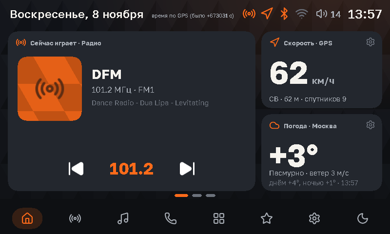
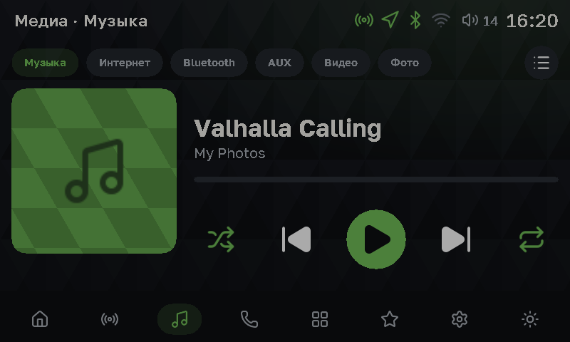
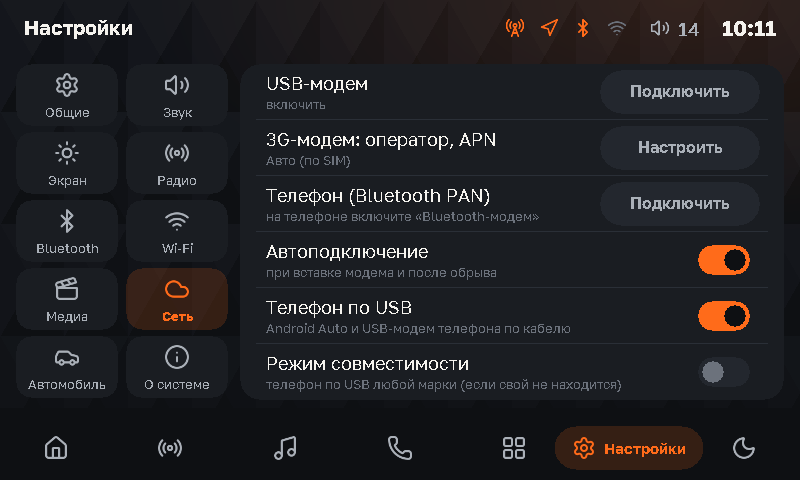

# VestaHome

Оболочка для головного устройства Lada Vesta (Windows CE 6.0, прошивка 4120, экран 800×480). Заменяет штатное
меню. Радио, музыка, телефон и настройки остаются. К ним добавляются интернет, виджеты, OBD и камеры контроля
скорости. Программа бесплатная.



## Что нового по сравнению со штатной оболочкой

- **Главный экран с виджетами:** музыка, скорость, погода, пробки, поездка, телефон, календарь, ярлыки программ.
- **Интернет в машине** через Wi-Fi, USB-модем или телефон по Bluetooth.
- **Интернет-радио** со своим списком станций.
- **OBD-адаптер ELM327:** обороты, температуры, расход, запас хода, ошибки двигателя с расшифровкой и сбросом.
- **Бортовой компьютер** поездки.
- **Камеры контроля скорости** с базой, звуком и предупреждением о превышении.
- **GPS для сторонних навигаторов** через COM-порт, без GpsGate.
- **Свои виджеты** одним текстовым файлом и **дополнения** со своими экранами.
- **Запуск как в прошлый раз:** тот же экран, источник и трек после включения.
- **Цвета кузова Vesta** в оформлении, заставка с часами, своя картинка загрузки.
- **Диспетчер задач, редактор файлов, диагностика.**
- **Безопасный возврат** к штатной оболочке: она остаётся на ГУ и запускается сама, если с VestaHome что-то не так.

<p>


</p>

## Установка

1. Скачайте архив `VestaHomeInstall` из [Releases](../../releases) и распакуйте на SD-карту. Папки `SafeMode` и
   `SPIPower_rescue` в архиве — аварийные, они нужны только при проблеме.
2. Вставьте карту в ГУ и запустите `VestaHomeInstall.exe` (например, через проводник).
3. Нажмите **УСТАНОВИТЬ / ОБНОВИТЬ** и перезагрузите ГУ, не вынимая карту.

Подробно — в [руководстве пользователя](docs/manual.md#2-установка-обновление-удаление).

## Документация

- [Руководство пользователя](docs/manual.md)
- [API дополнений](docs/plugin-api.md) — для разработчиков

## Сборка

Нужна Visual Studio 2005 с поддержкой Smart Devices (ARM, SDK Pocket PC 2003).

```
VestaHome\native\build.bat        → VestaHome\VestaHome\VestaHome.exe (ГУ) и VestaHomePC.exe (ПК)
VestaNMEA\native\build.bat        → порт GPS для навигаторов
VestaModem\native\build.bat       → USB-модем
VestaStub\native\build.bat        → загрузчик
SPIPower\install\build.bat        → установщик VestaHomeInstall.exe (собирать последним)
```

Общие модули — подмодуль `core` ([VestaCore](https://github.com/TpuPyku/VestaCore)).

## Другие программы

- [OSMapsCE](https://github.com/TpuPyku/OSMapsCE) — карта OpenStreetMap с пробками и офлайн-маршрутами.
- [YaMapsCE](https://github.com/TpuPyku/YaMaps) — карта Яндекса с пробками.
- [VestaLaunch](https://github.com/TpuPyku/VestaLaunch) — запуск программ с кнопки «Навигация».

## Поддержать проект

VestaHome бесплатен. Если программа вам понравилась:

- поставьте ⭐ звезду репозиторию (кнопка **Star** вверху страницы) — так VestaHome проще найти другим владельцам Весты;
- поддержите разработку на [Boosty](https://boosty.to/vesta_home) — добровольно, VestaHome остаётся бесплатным.
