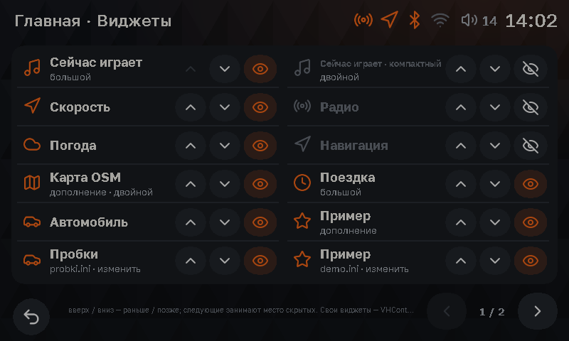
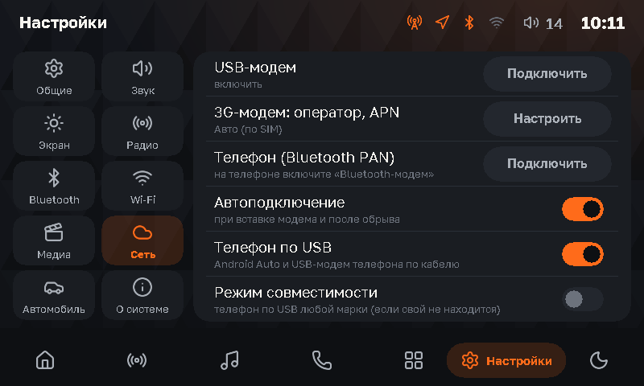
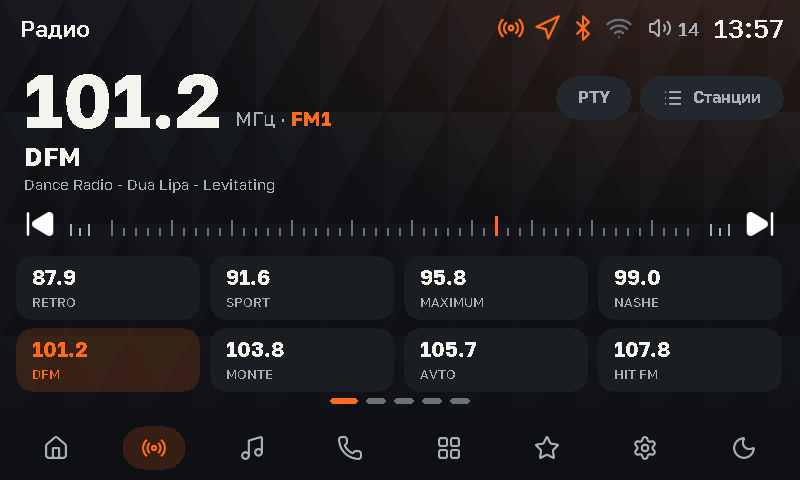
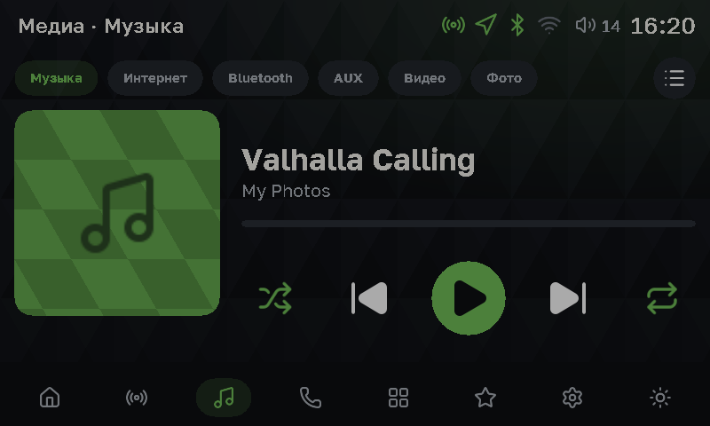
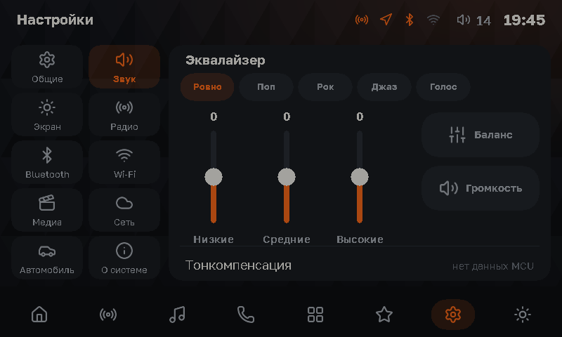
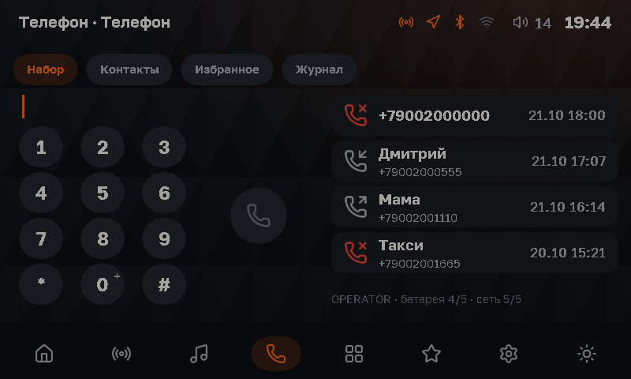
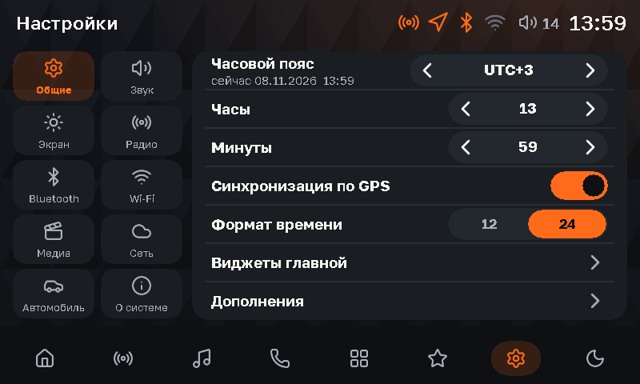
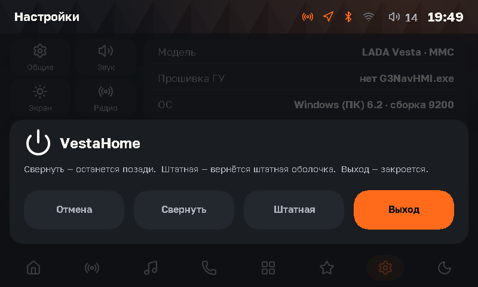

# VestaHome — руководство пользователя

VestaHome — оболочка для головного устройства (ГУ) Lada Vesta с прошивкой 4120. Она заменяет штатное меню:
радио, музыка, телефон и настройки остаются, а к ним добавляются интернет, виджеты, камеры контроля скорости
и многое другое. Программа бесплатная.

Версия программы видна в «Настройки → О системе». Номер вида `0.6.ГГММДД`: в конце стоит дата сборки.

**Содержание**

1. [Чем VestaHome отличается от штатной оболочки](#1-чем-vestahome-отличается-от-штатной-оболочки)
2. [Установка, обновление, удаление](#2-установка-обновление-удаление)
3. [Главный экран](#3-главный-экран)
4. [Интернет: Wi-Fi, USB-модем, телефон](#4-интернет-wi-fi-usb-модем-телефон)
5. [Радио и медиа](#5-радио-и-медиа)
6. [Телефон](#6-телефон)
7. [Машина](#7-машина)
8. [Вид](#8-вид)
9. [Свои виджеты и дополнения](#9-свои-виджеты-и-дополнения)
10. [Настройки](#10-настройки)
11. [Сервис](#11-сервис)
12. [Безопасность и возврат к штатной оболочке](#12-безопасность-и-возврат-к-штатной-оболочке)
13. [Журналы и помощь](#13-журналы-и-помощь)
14. [Другие наши программы](#14-другие-наши-программы)

---

## 1. Чем VestaHome отличается от штатной оболочки

### Новое

- **Главный экран с виджетами.** Музыка, скорость, погода, пробки, поездка, телефон, календарь, ярлыки программ.
  Виджеты стоят на нескольких страницах. Их порядок и набор вы выбираете сами. → [раздел 3](#3-главный-экран)
- **Интернет в машине.** Через Wi-Fi, через 3G-модем в USB или через телефон по Bluetooth. Музыка с телефона при
  этом продолжает играть. → [раздел 4](#4-интернет-wi-fi-usb-модем-телефон)
- **Интернет-радио.** Свой список станций, MP3 и OGG. → [раздел 5](#5-радио-и-медиа)
- **Погода и пробки** на главном экране. Погода по GPS или для домашней точки.
- **Бортовой компьютер:** пробег поездки, время в движении, средняя и максимальная скорость; внизу — когда следующее ТО. Шестерёнка виджета: пробег сейчас (как на приборной панели — дальше VestaHome считает сам по скорости), пробег и дата прошлого ТО (вводятся цифрами, точки в дате ставятся сами: 14112026 → 14.11.2026), переключатель «Рекомендуемое ТО каждые 7000 км» (выключен — по регламенту Весты: 15 000 км или раз в год, что раньше) и кнопка «ТО пройдено» — отмечает ТО сегодня на текущем пробеге.
- **Камеры контроля скорости.** База скачивается с speedcamonline.ru или берётся из файла iGO / Navitel.
  Предупреждение знаком и звуком, отдельный сигнал при превышении.
- **GPS для сторонних навигаторов.** Порт COM6 (номер можно сменить) отдаёт данные GPS машины. Навител, iGO и
  другие видят спутники без GpsGate. Порт могут читать несколько программ сразу.
- **Свои виджеты и дополнения.** Виджет описывается одним текстовым файлом. Дополнение добавляет свои экраны и
  кнопки. → [раздел 9](#9-свои-виджеты-и-дополнения)
- **Живая карта OSMapsCE** прямо на главном экране (если установлена OSMapsCE).
- **Цвет оформления** из палитры кузова Vesta, заставка с часами, своя картинка загрузки. → [раздел 8](#8-вид)
- **Сервис:** диспетчер задач, редактор текстовых файлов, диагностика экрана, звука, CAN и MCU. → [раздел 11](#11-сервис)

### Удобнее

- **Запуск как в прошлый раз.** После включения открывается тот же экран и тот же источник. Музыка продолжается с
  того же файла.
- **Радио.** Автопоиск показывает найденные станции списком, а одной кнопкой их можно записать в пресеты. Есть
  поиск станции по жанру (PTY).
- **Медиа.** Все источники на одном экране: музыка, интернет-радио, Bluetooth, AUX, видео, фото. Обложки и теги,
  миниатюры фото, слайд-шоу.
- **Телефон.** Поиск по контактам, избранное, книга телефона или SIM. Новый телефон можно сопрячь прямо с ГУ.
- **Wi-Fi.** Сохранённые сети, пароль вводится один раз, точка доступа ГУ.
- **Громкость.** Своя громкость для навигации и кнопок. Ограничение громкости при включении.
- **Двойное нажатие MUTE** на панели ГУ выводит VestaHome вперёд из любой программы. Звук при этом не меняется.

### Надёжность

- Если VestaHome трижды подряд не проработает 3 минуты, ГУ сама вернётся к штатной оболочке.
- Журналы пишутся только на SD-карту или флешку. Встроенная память ГУ не изнашивается.
- Штатная оболочка остаётся на месте. Вернуть её можно в любой момент. → [раздел 12](#12-безопасность-и-возврат-к-штатной-оболочке)

---

## 2. Установка, обновление, удаление

Всё ставит один файл — `VestaHomeInstall.exe`. Его можно запускать с SD-карты, с флешки или из памяти ГУ.

**Перед началом.** Вставьте SD-карту в ГУ. Она должна оставаться в слоте всё время установки. В корне карты не
должно быть файлов `SwDnl.exe`, `update.pkg`, `RdDnl.upg`, `CANUpdate.s19`: с ними ГУ начнёт заводское обновление.

### Первая установка

1. Запустите `VestaHomeInstall.exe`. Сверху виден отчёт о состоянии. Ниже две отметки, обе включены:
   - **VestaHome + загрузчик** — сама оболочка и загрузчик, который запускает её после включения ГУ;
   - **Proxy MCU + Bluetooth** — две системные библиотеки. Через них VestaHome получает кнопки, радио, звук и
     телефон. Заводские файлы сохраняются.
2. Нажмите **УСТАНОВИТЬ / ОБНОВИТЬ** и подтвердите. VestaHome ставится сразу. Загрузчик и proxy ставятся при
   следующей загрузке.
3. Перезагрузите ГУ, не вынимая SD-карту. Первая загрузка идёт дольше обычной. Логотип LADA может висеть около
   минуты, потом ГУ перезагрузится ещё раз сама. Ничего не нажимайте и не выключайте.
4. После загрузки сразу запускается VestaHome.

Если прошивка не 4120, proxy не установится и ничего не изменится. Передумали до перезагрузки — нажмите
**ОТМЕНИТЬ ЗАДАНИЕ**.

### Обновление

Запустите новый `VestaHomeInstall.exe` и нажмите **УСТАНОВИТЬ / ОБНОВИТЬ**. VestaHome закроется и запустится снова
уже новой версией. Перезагрузка нужна, только если отмечен proxy. Настройки, пароли Wi-Fi, ярлыки и база камер
сохраняются.

### Удаление

Отметьте, что удалить, и нажмите **УДАЛИТЬ ОТМЕЧЕННОЕ**. VestaHome удаляется сразу вместе с настройками. Штатная
оболочка и заводские библиотеки вернутся при следующей загрузке. Перезагружайте ГУ с SD-картой в слоте.

---

## 3. Главный экран

**Верхняя строка.** Слева название экрана, на главной — дата. Справа значки: флешка и SD-карта, Wi-Fi, Bluetooth
(цветной, если телефон подключён), GPS (цветной, если есть координаты), что играет, громкость и часы. Громкость —
это число рядом с динамиком, «×» значит звук выключен. Когда крутите ручку, окно не выскакивает: число меняется
прямо в строке. Нажмите на динамик, чтобы увидеть громкость крупно. Если впереди камера контроля скорости, вверху
появляется плашка со знаком и расстоянием. При превышении она красная и показывает скорость.

**Нижняя панель** — разделы: Главная, Радио, Медиа, Телефон, Приложения, кнопки дополнений, Настройки, день и ночь.
На вложенных экранах панели нет. Назад ведёт круглая кнопка в левом нижнем углу.

**Страницы.** Виджеты листаются пальцем. Точки под виджетами показывают текущую страницу.

**Приложения** — ярлыки программ, например навигатора. Карандаш вверху включает правку: нажмите на ярлык, чтобы
поменять название, программу, параметры и значок, или на «Добавить». Не забудьте нажать **СОХРАНИТЬ**.

### Виджеты

- **Сейчас играет** — то, что звучит: интернет-радио, музыка, радио FM или музыка с телефона. Кнопки ⏮ ⏯ ⏭
  работают для каждого источника. Если ничего не играет, виджет показывает последнее, что вы слушали, и ▶
  продолжает. Есть компактный вариант в одну строку.
- **Поездка** — пробег, время в движении, средняя и максимальная скорость.
- **Скорость** — скорость, направление, высота, спутники. Если впереди камера, виджет показывает её знак и
  расстояние.
- **Погода** — по GPS или для домашней точки. Источник: Open-Meteo (без ключа), OpenWeather или Яндекс (свой ключ).
  Домашняя точка в шестерёнке виджета: название, «Широта дома» и «Долгота дома» — каждая цифрами (точка, минус для южной и западной), или «Из GPS».
- **Пробки** — баллы Яндекс Пробок. По умолчанию для Москвы, город меняется в файле виджета
  ([раздел 9](#9-свои-виджеты-и-дополнения)).
- **Автомобиль** — три показания на выбор.
- **Радио**, **Телефон** (оператор, батарея, вызов), **Календарь** (дата, восход и закат), **Навигация** (открыть
  навигатор), **Приложения** (ярлыки программ).
- **Карта OSM** — живая карта вокруг машины из OSMapsCE. Если едете по маршруту, на других экранах следующий манёвр виден в верхней строке; нажмите на него, чтобы открыть карту. Во время маршрута карта повёрнута по ходу движения, на ней
  следующий манёвр, время прибытия и остаток пути.

**Настроить главный экран:** «Настройки → Общие → Виджеты главной». Стрелки двигают виджет раньше или позже.
Глаз показывает или скрывает его. Скрытый виджет не работает совсем: не ходит в сеть и не читает данные.
Шестерёнка в заголовке виджета открывает его настройки.

---

## 4. Интернет: Wi-Fi, USB-модем, телефон

Интернет нужен для погоды, пробок, интернет-радио, базы камер и онлайн-карт. Подойдёт любой из трёх способов.

### Wi-Fi

«Настройки → Wi-Fi». Нажмите на сеть, чтобы подключиться. Пароль спрашивается один раз. «Сохранённые» — все
запомненные сети, там же «Забыть» (нажать дважды). Здесь же включается точка доступа ГУ.

### USB-модем

3G-модем Huawei и похожие (проверен E3121) с SIM-картой. «Настройки → Сеть»:

- **Автоподключение** включено сразу. Вставили модем с SIM-картой — он подключится сам. Связь пропала — VestaHome
  попробует снова через 30 секунд, потом реже, но не реже раза в 5 минут.
- **Подключить / Отключить** — вручную. Строка под «USB-модем» показывает состояние: вставьте модем, нет SIM-карты,
  сигнал, в сети, ошибка. После «Отключить» модем сам не подключится, пока его не вынут и не вставят снова.
- **Оператор модема.** «Авто (по SIM)» выбирает настройки по SIM-карте. Можно выбрать оператора из списка (Россия,
  Казахстан, Беларусь, Узбекистан, Киргизия, Армения, Азербайджан). «Свой» — всё вручную.
- **APN**, **Логин и пароль** — нажатие открывает клавиатуру. После правки оператор станет «Свой».

### Телефон по Bluetooth

Интернет телефона, который уже подключён к ГУ по Bluetooth.

1. На телефоне (Android): «Точка доступа и модем» → включите «Bluetooth-модем».
2. На ГУ: «Настройки → Сеть → Телефон (Bluetooth)» → **Подключить**.
3. Строка покажет «в сети» и адрес.

Звонки и музыка с телефона при этом работают. При большой загрузке сети музыка может прерываться: у них общий канал
Bluetooth.

---

## 5. Радио и медиа

### Радио

Частота крупно, под ней диапазон и RDS: название станции и радиотекст. Стрелки по краям шкалы ищут станцию вниз или
вверх. Пресеты: FM1, FM2, FM3 по 8 станций, УКВ, СВ. Страницы пресетов листаются свайпом. Короткое нажатие на пресет
включает станцию, долгое сохраняет туда текущую.

- **PTY** — поиск станции по жанру.
- **Автопоиск** («Радио → Станции → Автопоиск») проходит весь диапазон и показывает до 30 станций списком, по 5
  на странице. Пресеты при этом не меняются. Чтобы записать найденное в пресеты, нажмите **В пресеты** и в течение 4 секунд ещё раз.
  Станции лягут в пресеты 1–24 по порядку частот.

### Медиа

Вкладки: **Музыка**, **Интернет**, **Bluetooth**, **AUX**, **Видео**, **Фото**. Кнопка «Медиа» открывает последнюю
вкладку.

Длинные списки (музыка, видео, фото, интернет-радио, контакты, журнал звонков) листаются страницами: кнопками ‹ ›
справа внизу (на экранах с нижней строкой — справа от пути) или свайпом; нижняя строка при этом стоит на месте.
Точки над нижней строкой показывают страницу. Найденные станции радио и короткие списки в настройках (сети Wi-Fi,
сопряжённые телефоны) прокручиваются пальцем.

- **Музыка** — файлы с SD-карты, флешки и встроенной карты. Сверху путь: «‹» ведёт на уровень выше, нажатие на путь
  меняет носитель. Плеер показывает обложку и теги. Есть «Играть всё», повтор и случайный порядок.
- **Интернет** — интернет-радио. Кнопка списка вверху справа открывает станции. Над станциями четыре вкладки:
  - **Мои станции** — из файла `radio.txt` рядом с программой, его можно дополнить;
  - **Избранное** — станции, у которых вы нажали звёздочку ☆. Звёздочка есть у каждой станции и в плеере рядом
    с названием. Нажмёте ещё раз — станция уйдёт из избранного;
  - **Недавние** — 20 последних станций, которые вы включали, последняя сверху;
  - **Каталог** — тысячи станций со всего мира (radio-browser.info). Выберите «Популярные», страну, где вы сейчас (вторая плитка, по GPS; без GPS — «СНГ»), жанр,
    страну или язык. Станции идут по 20, дальше — «Ещё 20». «Поиск» ищет станцию по названию. Кнопка
    «Каталог» над станциями возвращает к выбору и к вкладкам.

  ⏮ ⏭ и кнопки на руле листают станции того списка, из которого играет станция. Он написан в плеере над
  названием, нажатие на эту строку открывает список.

  

  
- **Bluetooth** — музыка с телефона: трек, ⏮ ⏯ ⏭. Если телефон сам начнёт играть при другом источнике (например, звук уведомления), VestaHome сразу ставит его на паузу, как штатная оболочка; музыку телефона включают вкладкой Bluetooth или кнопкой MODE.
- **AUX** — звук с разъёма 3,5 мм. Вкладка включает этот вход, как пункт AUX штатного меню. Громкость регулируется
  на самом источнике.
- **Видео** — плеер на весь экран. В движении картинка встаёт на паузу (настройка «Видео в движении»).
- **Фото** — миниатюры, просмотр на весь экран, поворот, слайд-шоу.

### Звук

«Настройки → Звук»: громкость, эквалайзер, баланс и фейдер (точка на схеме машины), тонкомпенсация, громкость от
скорости. На экране баланса — «Алгоритм изменения громкости», как в штатной оболочке. MCU не сообщает состояние
этих двух переключателей, поэтому они показывают то, что было выбрано в VestaHome последним. «Громкость» — для
навигации и кнопок. «Макс. при включении»: если при выключении было громче, VestaHome убавит звук до этого уровня.

---

## 6. Телефон

Разделы телефона — вкладки сверху: **Набор**, **Контакты** (книга телефона или SIM, поиск), **Избранное**
(звёздочка в карточке контакта) и **Журнал** (входящие, исходящие, пропущенные). На «Наборе» слева номер и клавиши,
зелёная кнопка — вызов, справа последние звонки (нажатие — перезвонить). Если телефон не подключён, справа кнопки
«Подключить» и «Сопряжённые». При входящем звонке окно открывается само.
Кнопка «телефон» на руле отвечает, «положить трубку» завершает разговор.

«Настройки → Bluetooth»: сверху переключатель Bluetooth, как у Wi-Fi. Выключили — телефон отключается, ГУ его
не ищет. Включили — через несколько секунд последний телефон подключается сам. Ниже: подключённый телефон и его
связь (музыка, звонки, батарея), автосоединение, автоответ, список сопряжённых телефонов. Выключенный Bluetooth
остаётся выключенным и после перезагрузки.

### Новый телефон

«Настройки → Bluetooth → Сопряжённые → **+ НОВЫЙ ТЕЛЕФОН**». Есть два способа.

**С ГУ.** На телефоне включите Bluetooth и видимость. На ГУ нажмите **НАЙТИ** и подождите около 10 секунд. Выберите
свой телефон → **СОПРЯЧЬ** (PIN 1234 или 0000) → подтвердите на телефоне → **ПОДКЛЮЧИТЬ**.

**С телефона.** Нажмите **СДЕЛАТЬ ГУ ВИДИМОЙ**: ГУ будет видна 2 минуты. Найдите ГУ в настройках Bluetooth телефона.
На ГУ появится окно с именем телефона и кодом. Если код совпадает с кодом на телефоне, нажмите **ПРИНЯТЬ**.

Если телефон нужен и как модем, включите на нём «Bluetooth-модем» **до** сопряжения: иначе ГУ не узнает, что
телефон раздаёт интернет. После удаления сопряжения новый телефон сопрягается только после перезагрузки ГУ.

Убрать сопряжение — **УДАЛИТЬ** в списке сопряжённых (нажать дважды). Поиск и сопряжение работают только с proxy
(отметка «Proxy MCU + Bluetooth» в установщике).

---

## 7. Машина

### Экран «Автомобиль»

Нажмите на виджет «Автомобиль»: скорость и угол руля (от CAN-модуля), поездка, температуры ГУ, GPS. Прочерк
значит, что этого значения сейчас нет.

OBD-адаптер (ELM327) в этой версии выключен: он мешал телефону подключаться. Он вернётся в следующей версии.

### Камеры контроля скорости

Шестерёнка виджета «Скорость»:

- **Предупреждать о камерах** — знак на виджете и в верхней строке.
- **Звуковой сигнал** — «Выкл», «Всегда» (на каждую камеру) или «Превышение» (только если вы едете быстрее лимита
  камеры на заданный порог).
- **Порог превышения** — кнопками − и +, по 1 км/ч.
- **Дистанция** — за 10 секунд до камеры (по скорости) или 200, 400, 600 м.
- **Скачать базу камер** с speedcamonline.ru: выберите регионы (например, Москва — 77, область — 50) и типы камер.
  «Раз в неделю» — база обновляется сама. Можно взять и **файл камер** iGO или Navitel.

### Камера заднего хода

На заднем ходу поверх всего показывается картинка камеры с разметкой по углу руля. После заднего хода VestaHome
возвращает экран, где вы были. Проверить без заднего хода: «Настройки → Автомобиль → Камера — Показать».

### Порт для навигаторов

«Настройки → Автомобиль → Порт для навигаторов». VestaHome отдаёт данные GPS машины в COM-порт (115200). По умолчанию
это COM6, номер меняется стрелками от COM5 до COM9. Укажите тот же порт в навигаторе. Навител после GpsGate ищет
COM7 — тогда проще выбрать COM7 здесь.

Навител со старыми настройками сбивает часы ГУ на 2007 год: он ставит время по GPS, а считает его в эпохе GPS
1999–2019. Перед запуском Навитела из «Приложений» VestaHome сам ставит в его настройках эпоху 2019–2038
(`GPSEpoch = 2` в `Userdata\settings*.ini`).

---

## 8. Вид

- **Цвет акцента.** «Настройки → Экран → Тема». Оранжевый можно сменить на другой цвет кузова Vesta: Сердолик,
  Карфаген, Криптон, Дайвинг, Булат, Платина.
- **День и ночь** — по солнцу (по GPS), всегда день или всегда ночь. Кнопка на нижней панели переключает вручную.
- **Заставка** включается через заданное число минут. Она показывает часы, погоду и то, что играет. Фон — «Мозаика»
  или «Своя картинка»: любая PNG, JPG или BMP с SD-карты или флешки.
- **Картинка загрузки.** Пока VestaHome запускается, на экране картинка «VestaHome». Свою картинку 800×480 положите в
  папку `Skin` программы под именем `bootmy.png` или `bootmy.jpg`.

---

## 9. Свои виджеты и дополнения

### Свои виджеты

Виджет — файл `<имя>.ini` в папке `VHContent\VHWidgets` на встроенном разделе (`\ResidentFlash`) или на SD-карте (`\SDMemory`). Со встроенного раздела он готов сразу при запуске VestaHome. Виджет, скрипт которого часто пишет файлы рядом с собой, держите на SD: так не изнашивается встроенная память. Старые папки `VestaWidgets` на картах тоже читаются. Установщик кладёт на встроенный раздел примеры, в том числе виджет «Пробки», и описание полей `README.txt`.

- Виджет может брать данные из интернета (`url=`) или из своего скрипта.
- Показать, скрыть, переставить — «Настройки → Общие → Виджеты главной».
- Изменить — там же нажмите на название своего виджета. Откроется встроенный редактор.
- Скачанные данные хранятся в оперативной памяти. После выключения ГУ они скачаются заново.

### Дополнения

Дополнение — отдельная программа. Она добавляет в VestaHome виджеты, экраны и до двух кнопок в нижнюю панель.
Дополнения лежат в папке `VHContent\VHPlugins` на `\ResidentFlash` или на SD-карте (`VHPlugins\<Имя>\<Имя>.exe`) и запускаются вместе с VestaHome.
«Настройки → Общие → Дополнения» — список, состояние, кнопка «Открыть» и выключатель. Описание для разработчиков —
[plugin-api.md](plugin-api.md).

---

## 10. Настройки

Слева разделы, справа их строки.

- **Общие** — часовой пояс, время вручную, синхронизация по GPS, формат 12 или 24 часа, виджеты главной, дополнения.
- **Звук** — громкость, эквалайзер, баланс, громкость от скорости ([раздел 5](#звук)).
- **Экран** — день и ночь, подсветка, заставка, калибровка экрана, тема.
- **Радио** — RDS, AF, TA, CT, шумоподавление, СВ.
- **Bluetooth** — вкл/выкл, телефон, сопряжённые.
- **Wi-Fi** — сети, сохранённые сети, точка доступа.
- **Медиа** — видео (масштаб, видео в движении) и фото (интервал слайд-шоу, масштаб, автоповорот).
- **Сеть** — USB-модем и телефон по Bluetooth ([раздел 4](#4-интернет-wi-fi-usb-модем-телефон)).
- **Автомобиль** — порт GPS, данные CAN и MCU, камера заднего хода, объём бака, порт для навигаторов.
- **О системе** — версия, память, лицензии, диагностика, окно питания.

---

## 11. Сервис

### Диспетчер задач

«Приложения → значок активности». Графики загрузки процессора и памяти, вкладки «Процессы» и «Окна». Выберите строку
и нажмите «Переключиться» или «Завершить».

### Редактор текстовых файлов

«О системе → Диагностика → Текстовые файлы». Открывает `.ini`, `.txt` и `.cfg`.

- Первое нажатие выделяет строку, второе открывает клавиатуру. В строках «ключ=значение» меняется только значение.
- Курсор ставится пальцем. Долгое нажатие на строку ввода — копировать, вставить, очистить.
- **+ СТРОКА**, **УДАЛИТЬ** (дважды), **СОХРАНИТЬ**. Прежний файл остаётся рядом с расширением `.bak`.

### Диагностика

«О системе → Диагностика»: проверка экрана и касаний, калибровка, память и диски, кнопки и MCU, звук и видео, поток
CAN и GPS, проба USB-модема, выключатель журналов.

### Окно питания

Кнопка питания в «О системе»:

- **Свернуть** — VestaHome уходит назад.
- **Штатная** — перезагрузить ГУ в штатную оболочку. Перед этим VestaHome переключает звук на радио и выключает свой Bluetooth. Штатная будет запускаться при каждом включении, пока вы не запустите VestaHome вручную (VestaLaunch или проводник) и не ответите «Да» на «Перезагрузить в VestaHome?». Если штатная после перезагрузки не отвечает, выключите и включите ГУ крутилкой.
- **Выход** — закрыть VestaHome.

Удержание ручки громкости — перезагрузка ГУ. Её можно отменить кнопкой «Отмена».

---

## 12. Безопасность и возврат к штатной оболочке

Штатная оболочка остаётся на ГУ. Она запустится вместо VestaHome, если:

- VestaHome трижды подряд не проработал 3 минуты;
- в корне SD-карты или флешки лежит пустой файл `VestaStub.off`;
- вы нажали «Штатная» в окне питания (до возврата в VestaHome вручную) или «Выход» (до следующего включения).

**Если что-то пошло не так**

- ГУ перезагружается по кругу после установки proxy. Оставьте SD-карту в слоте: установщик сам вернёт заводские
  файлы.
- Не помогло. На компьютере скопируйте в корень SD-карты содержимое папки `SPIPower_rescue` из архива. Вставьте
  карту и включите ГУ. Появится «Update Start!» или «OK» — нажмите.
- Оболочка совсем не загружается. Скопируйте в корень SD-карты содержимое папки `SafeMode`. После включения
  запустится проводник, наши программы будут отключены.

Подробности — в файле `help.txt` рядом с установщиком.

---

## 13. Журналы и помощь

Журналы включены по умолчанию. Выключатель: «О системе → Диагностика → Журналы». Журналы пишутся только на SD-карту
или флешку, в папку `VestaLogs`. Во встроенную память ГУ они не пишутся никогда.

При проблеме пришлите:

- папку `\SDMemory\VestaLogs` целиком;
- `\SDMemory\SPIPower_boot\boot.log`, если проблема при загрузке;
- фото экрана установщика с отчётом.

Вопросы и ошибки — в [Issues](https://github.com/TpuPyku/VestaHome/issues).

---

## 14. Другие наши программы

- **OSMapsCE** — карта OpenStreetMap с пробками Яндекса и 2ГИС, офлайн-карты областей, поиск и маршруты без
  интернета. При запущенном VestaHome добавляет на главную виджет «Карта OSM». Нажатие на виджет открывает карту на
  весь экран. [github.com/TpuPyku/OSMapsCE](https://github.com/TpuPyku/OSMapsCE)
- **YaMapsCE** — карта Яндекса с пробками. [github.com/TpuPyku/YaMaps](https://github.com/TpuPyku/YaMaps)
- **VestaLaunch** — запуск программ с кнопки «Навигация» штатной оболочки.
  [github.com/TpuPyku/VestaLaunch](https://github.com/TpuPyku/VestaLaunch)

**Поддержать проект.** Поставьте ⭐ звезду репозиторию [VestaHome](https://github.com/TpuPyku/VestaHome) — так его
проще найти другим. Поддержать разработку можно на [Boosty](https://boosty.to/vesta_home): это добровольно, всё
в VestaHome остаётся бесплатным.
