# VestaHome — руководство пользователя

VestaHome — оболочка для головного устройства (ГУ) MMC Lada Vesta WinCE 6 с прошивкой 4120. Она заменяет штатное меню:
радио, музыка, телефон и настройки остаются, а к ним добавляются интернет, виджеты, камеры контроля скорости
и многое другое. Программа бесплатная.

Версия программы видна в «Настройки → О системе». Номер вида `1.0.ГГММДД`: в конце стоит дата сборки.

**Содержание**

1. [Чем VestaHome отличается от штатной оболочки](#1-чем-vestahome-отличается-от-штатной-оболочки)
2. [Установка, обновление, удаление](#2-установка-обновление-удаление)
3. [Как устроен экран](#3-как-устроен-экран)
4. [Настройки](#4-настройки)
5. [Главная и виджеты](#5-главная-и-виджеты)
6. [Радио](#6-радио)
7. [Медиа](#7-медиа)
8. [Телефон](#8-телефон)
9. [Приложения](#9-приложения)
10. [Дополнения](#10-дополнения)
11. [Безопасность и возврат к штатной оболочке](#11-безопасность-и-возврат-к-штатной-оболочке)
12. [Журналы и помощь](#12-журналы-и-помощь)
13. [Другие наши программы](#13-другие-наши-программы)

---

## 1. Чем VestaHome отличается от штатной оболочки

### Новое

- **Главный экран с виджетами.** Музыка, скорость, погода, пробки, поездка, телефон, календарь, ярлыки программ.
  Виджеты стоят на нескольких страницах. Их порядок и набор вы выбираете сами. → [раздел 5](#5-главная-и-виджеты)
- **Интернет в машине.** Через Wi-Fi, через 3G-модем в USB, через телефон по USB кабелю или по Bluetooth. Музыка с телефона при
  этом продолжает играть. → [Wi-Fi](#wi-fi), [Сеть](#сеть)
- **Интернет-радио.** Свой список станций, MP3 и OGG. → [раздел 7](#7-медиа)
- **Погода и пробки** на главном экране. Погода по GPS или для домашней точки.
- **Бортовой компьютер:** пробег поездки, время в движении, средняя и максимальная скорость; внизу — когда следующее
  ТО. → [виджет «Поездка»](#поездка-и-то)
- **Камеры контроля скорости.** База берётся из регионов карт OSMapsCE (openspeedcam.net),
  скачивается с speedcamonline.ru или из файла формата iGO / Navitel. Предупреждение знаком и звуком, отдельный сигнал при превышении. → [раздел 5](#камеры-контроля-скорости)
- **GPS для сторонних навигаторов.** Порт COM6 (номер можно сменить) отдаёт данные GPS машины. Навител, iGO и
  другие видят спутники без GpsGate. Порт могут читать несколько программ сразу. → [порт для навигаторов](#порт-для-навигаторов)
- **Свои виджеты и дополнения.** Виджет описывается одним текстовым файлом. Дополнение добавляет свои экраны и
  кнопки, например Android Auto. → [свои виджеты](#свои-виджеты), [раздел 10](#10-дополнения)
- **Живая карта OSMapsCE** прямо на главном экране (если установлена OSMapsCE).
- **Цвет оформления** из палитры кузова Vesta, заставка с часами, своя картинка загрузки. → [Экран](#экран)
- **Сервис:** диспетчер задач, редактор текстовых файлов, диагностика экрана, звука, CAN и MCU. →
  [диспетчер задач](#диспетчер-задач), [О системе](#о-системе)

### Удобнее

- **Медиа.** Все источники на одном экране: музыка, интернет-радио, Bluetooth, AUX, видео, фото. Обложки и теги,
  миниатюры фото, слайд-шоу.
- **Телефон.** Поиск по контактам, избранное, книга телефона или SIM.
- **Wi-Fi.** Сохранённые сети, точка доступа ГУ.
- **Громкость.** Своя громкость для навигации и кнопок. Ограничение громкости при включении.
- **Двойное нажатие кнопки MUTE** на панели ГУ выводит VestaHome вперёд из любой программы, если она например зависла.

### Надёжность

- Если VestaHome трижды подряд не проработает минуту, ГУ сама вернётся к штатной оболочке.
- Включённые журналы пишутся только на SD-карту или флешку. Встроенная память ГУ не изнашивается.
- Штатная оболочка остаётся на месте. Вернуть её можно в любой момент. → [раздел 11](#11-безопасность-и-возврат-к-штатной-оболочке)

---

## 2. Установка, обновление, удаление

Всё ставит один файл — `VestaHomeInstall.exe`. Его можно запускать с SD-карты, с флешки или из памяти ГУ.

**Перед началом.** Вставьте SD-карту в ГУ. Она должна оставаться в слоте всё время установки. В корне карты не
должно быть файлов `SwDnl.exe`, `update.pkg`, `RdDnl.upg`, `CANUpdate.s19`: с ними ГУ начнёт заводское обновление.

### Первая установка

#### Шаг 1. Положите установщик на SD-карту

1. На компьютере скачайте архив `VestaHomeInstall-<версия>.zip`.
2. Откройте архив. В нём есть папка `VestaHomeInstall`.
3. Вставьте SD-карту в компьютер.
4. Скопируйте папку `VestaHomeInstall` на SD-карту, в самый верх карты (не внутрь других папок).
5. Безопасно извлеките карту из компьютера.
6. Вставьте карту в ГУ машины. Включите ГУ.

#### Шаг 2. Запустите установщик

Штатная оболочка не умеет запускать программы с карты. Есть три способа обойти это. Выберите **один** — тот, что
вам проще.

##### Способ А. Через рабочий стол Windows (инженерное меню)

Подходит всем: ничего, кроме карты, не нужно.

1. Откройте главный экран штатной оболочки.
2. Найдите кнопку с буквой **«i»** и нажмите её. Откроется окно с информацией.
3. Теперь коснитесь углов этого окна, по одному, именно в таком порядке:
   1. левый верхний угол;
   2. правый верхний угол;
   3. правый нижний угол;
   4. левый нижний угол.

   Откроется служебное (инженерное) меню. Если не открылось — повторите касания чуть медленнее.
4. В служебном меню нажмите **«SYSTEM STATUS»**.
5. Снова коснитесь углов в том же порядке, но теперь углов **всего экрана**. Отступайте от края экрана примерно на
   1 см (на ширину пальца):
   1. левый верхний;
   2. правый верхний;
   3. правый нижний;
   4. левый нижний.

   Появится рабочий стол Windows с панелью внизу.
6. Нажмите кнопку **«Пуск»** (Start) в левом нижнем углу.
7. В меню нажмите **«Выполнить…»** (Run…).
8. В строке ввода напишите `explorer` и нажмите **OK**. Откроется проводник — окно с папками.
9. В проводнике откройте **«Мой компьютер»** (My Device), если вы ещё не там.
10. Откройте папку **`SDMemory`** — это ваша SD-карта.
11. Откройте папку **`VestaHomeInstall`**.
12. Дважды коснитесь файла **`VestaHomeInstall`** (`VestaHomeInstall.exe`). Откроется установщик → переходите к
    [шагу 3](#шаг-3-установите).

##### Способ Б. Кнопкой «Навигация» (через Updater)

Штатная оболочка по кнопке «Навигация» сначала запускает файл `UPDATE\Updater.exe` с SD-карты, если он там есть.
Этим и пользуемся.

1. Выньте SD-карту из ГУ и вставьте в компьютер.
2. На карте, в самом верху (рядом с папкой `VestaHomeInstall`), создайте новую папку и назовите её `UPDATE`
   (большими латинскими буквами).
3. Откройте папку `VestaHomeInstall` на карте. Скопируйте из неё файл `VestaHomeInstall.exe` в папку `UPDATE`.
4. В папке `UPDATE` переименуйте скопированный файл в `Updater.exe`. Должно получиться `UPDATE\Updater.exe`.
5. Безопасно извлеките карту и вставьте её в ГУ.
6. Если навигация уже открывалась после включения ГУ — перезагрузите ГУ: зажмите крутилку громкости на 10 секунд.
   Кнопка срабатывает, только пока навигатор ещё не запущен.
7. Нажмите на экране штатной оболочки кнопку **«Навигация»**. Откроется установщик → переходите к
   [шагу 3](#шаг-3-установите).
8. Когда VestaHome установится, удалите с карты папку `UPDATE`. Иначе при возврате к штатной оболочке установщик
   будет открываться при каждом нажатии «Навигации».

##### Способ В. Через лаунчер на кнопке «Навигация» («Программы»)

Подходит, если у вас уже стоит лаунчер, который открывается кнопкой «Навигация» (у некоторых она подписана
«Программы»): VestaLaunch, AppLauncher или другой.

1. Нажмите кнопку **«Навигация»** («Программы»). Откроется лаунчер.
2. Найдите в лаунчере, как запустить программу с карты: проводник, «Файлы», «Добавить программу» или похожее.
   - В **VestaLaunch**: нажмите плитку **«ДОБАВИТЬ»** → поле **«ПРОГРАММА»** → выберите `SDMemory` →
     `VestaHomeInstall` → `VestaHomeInstall.exe`. В поле **«НАЗВАНИЕ»** напишите, например, `Установка`. Нажмите
     **«СОХРАНИТЬ»**, затем нажмите новую плитку «Установка».
   - В другом лаунчере откройте его проводник или выбор файла и найдите тот же файл: `SDMemory` →
     `VestaHomeInstall` → `VestaHomeInstall.exe`.
3. Запустите файл. Откроется установщик → переходите к [шагу 3](#шаг-3-установите).

#### Шаг 3. Установите

1. В установщике сверху виден отчёт о состоянии. Ставится сама оболочка и загрузчик, который запускает её после
   включения ГУ. Если раньше стояла старая версия, которая подменяла две системные библиотеки, установщик сам вернёт
   заводские файлы: их работу теперь делает загрузчик.
2. Нажмите **УСТАНОВИТЬ / ОБНОВИТЬ**. VestaHome ставится сразу, без лишних вопросов (спросит, только если проверка
   ГУ нашла, что часть функций работать не будет). Загрузчик ставится при следующей загрузке.
3. Перезагрузите ГУ зажав крутилку громкости на 10 секунд, не вынимая SD-карту. Первая загрузка идёт дольше обычной. Логотип LADA может висеть около
   минуты, потом ГУ перезагрузится ещё раз сама. Ничего не нажимайте и не выключайте.
4. После загрузки сразу запускается VestaHome.

Системные файлы ГУ не подменяются, поэтому подходит любая прошивка ГУ. Перед установкой установщик проверяет ГУ: если для кнопок, звука и радио чего-то не хватает, установка не начнётся и ничего не изменится. Передумали до перезагрузки — нажмите
**ОТМЕНИТЬ ЗАДАНИЕ**.

### Обновление

Запустите новый `VestaHomeInstall.exe` и нажмите **УСТАНОВИТЬ / ОБНОВИТЬ**. VestaHome закроется и запустится снова
уже новой версией. Перезагрузка нужна, только если обновился загрузчик или убираются прежние proxy. Настройки, пароли Wi-Fi, ярлыки и база камер
сохраняются.

### Удаление

Нажмите **УДАЛИТЬ** и подтвердите. VestaHome удаляется сразу вместе с настройками. Штатная
оболочка и заводские библиотеки вернутся при следующей загрузке. Перезагружайте ГУ с SD-картой в слоте.

---

## 3. Как устроен экран

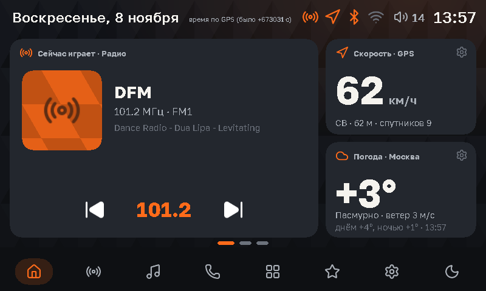

**Верхняя строка.** Слева название экрана, на главной — дата. Справа значки: флешка и SD-карта, Wi-Fi, Bluetooth
(цветной, если телефон подключён), GPS (цветной, если есть координаты), что играет, громкость и часы. Нажмите на значок, чтобы перейти в его настройки или событие. Если впереди камера контроля скорости, вверху
появляется плашка со знаком и расстоянием. При превышении она красная и показывает скорость.

**Нижняя панель** — разделы: Главная, Радио, Медиа, Телефон, Приложения, кнопки дополнений, Настройки, день и ночь.
На вложенных экранах панели нет. Назад ведёт круглая кнопка в левом нижнем углу.

---

## 4. Настройки

Слева разделы, справа их строки.


### Общие

Часовой пояс, время вручную, синхронизация по GPS, формат 12 или 24 часа, виджеты главной
([раздел 5](#настроить-главный-экран)), дополнения ([раздел 10](#10-дополнения)).

Откуда берётся время. При включении — из часов ГУ: они идут и при выключенной машине. Если в них нет даты (например,
GPS ни разу не ловил спутники), VestaHome берёт из них только время, а дату узнаёт из интернета, как только он
появится. Когда есть спутники, время ставится по GPS. Если включена синхронизация, все эти способы сами
поправляют часы.

### Звук


«Настройки → Звук»: эквалайзер (Ровно, Поп, Рок, Джаз, Голос и три полосы: низкие, средние, высокие) и две кнопки.

- **Баланс** — баланс и фейдер: нажмите или проведите точку на схеме машины, «В центр» возвращает середину.
- **Громкость** — «Навигация и кнопки» (подсказки навигаторов и звук нажатий) и «Макс. при включении»: если при
  выключении было громче, VestaHome убавит звук до этого уровня.

### Экран

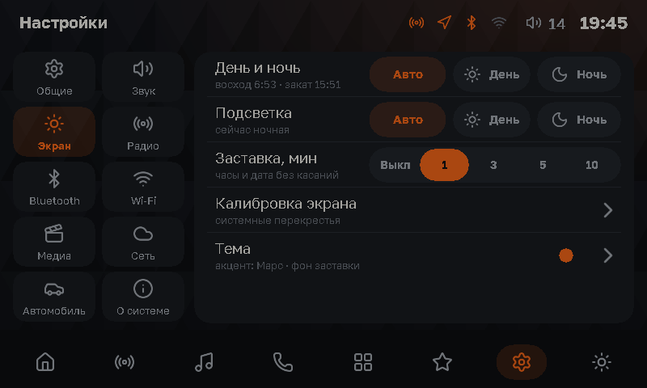

- **Цвет акцента.** «Настройки → Экран → Тема». Оранжевый можно сменить на другой цвет кузова Vesta: Сердолик,
  Карфаген, Криптон, Дайвинг, Булат, Платина.
- **День и ночь** — Затемнение темы по солнцу (по GPS), всегда день или всегда ночь. Кнопка на нижней панели переключает вручную.
- **Подсветка** — Яркость экрана авто, дневная или ночная.
- **Калибровка экрана** — системные перекрестья.
- **Заставка** включается через заданное число минут. Она показывает часы, погоду и то, что играет. Фон — «Мозаика»
  или «Своя картинка»: любая PNG, JPG или BMP с SD-карты или флешки.
- **Картинка загрузки.** Пока VestaHome запускается, на экране картинка «VestaHome». Свою картинку 800×480 положите в
  папку `Skin` программы под именем `bootmy.png` или `bootmy.jpg`.
- **Своё оформление** — цвета, значки и шрифт в файле `user_skin.ini`, см. ниже.

#### Своё оформление

Свои цвета, значки и шрифт кладите в папку `\ResidentFlash\VHContent\Skin\` (или `\SDMemory\VHContent\Skin\` на
SD-карте): файл `user_skin.ini` и картинки. Обновление VestaHome эту папку не трогает. Файл читается при запуске
VestaHome. В нём пишите только то, что меняете: остальное берётся из встроенного оформления (`Skin\skin.ini`
программы). Текст после `;` — комментарий. Ключи те же, что у VestaLaunch: один файл цветов подходит обеим
программам.

- **`[colors]`** — цвета в виде `RRGGBB`: `ink` (фон), `panel` (карточки, плитки, виджеты), `panel2` (кнопки,
  «пилюли», вложенные карточки), `line` (разделители), `text` (основной текст), `muted` (второстепенный текст),
  `dim` (неактивный текст), `accent` (нажатая кнопка, выбранное, заголовки), `facet` (уголок плитки), `off`
  (недоступное), `ok` (принять звонок), `stop` (сбросить, пропущенный), `margin` (поля вокруг фото), `mosaic1`…`mosaic4`
  (треугольники фона). Заданный здесь `accent` главнее выбора в «Теме» — там это видно надписью «задан в
  user_skin.ini». `facet` без `accent` считается от акцента.
- **`[images]`** — картинки (PNG, с прозрачностью) из этой папки: `background` (фон главного экрана 800×480),
  `saver` (фон заставки), `tile` (узор фона всех экранов) и значки — их имена в `Skin\skin.ini` программы
  (`radio`, `music`, `phone`…; `<имя>_down` — нажатая кнопка). Проще всего положить картинку с тем же именем файла,
  что в `Skin`: например, свой `radio.png` — и он заменит встроенный без строки в файле.
- **`[fonts]`** — свой шрифт: `face` — его имя (как в Windows), `regular` и `bold` — файлы `.ttf` в этой папке.

Пример:

```ini
[colors]
accent = 2E7DD7   ; синий
panel  = 15181D

[images]
radio = my_radio.png

[fonts]
face    = Roboto
regular = Roboto-Regular.ttf
bold    = Roboto-Bold.ttf
```

Каждая картинка занимает память ГУ: значок 64×64 — 16 КБ, фон — 750 КБ.

### Радио

Шумоподавление, диапазон СВ, RDS, AF (альтернативные частоты), CT (время по радио), TA (дорожные сообщения),
MS (музыка / речь).

### Bluetooth

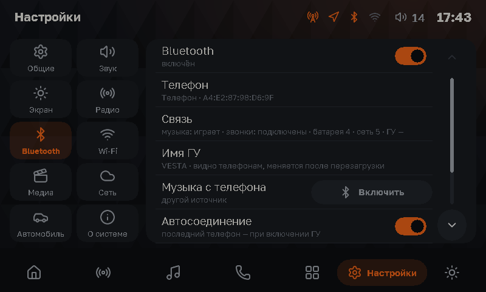

Сверху переключатель Bluetooth. Выключили — телефон отключается, ГУ его
не ищет. Включили — через несколько секунд последний телефон подключается сам. Выключенный Bluetooth
остаётся выключенным и после перезагрузки. Ниже:

- подключённый телефон и его связь (музыка, звонки, батарея);
- **Имя ГУ** — так ГУ видят телефоны, новое имя действует после перезагрузки;
- **Музыка с телефона** — «Включить» переключает звук на телефон;
- **Автосоединение** — последний телефон подключается при включении ГУ;
- **Автоответ** — входящий звонок принимается через 5 секунд;
- **Книга при подключении** — контакты обновляются с телефона сами, иначе кнопкой «Обновить»;
- список сопряжённых телефонов.

#### Новый телефон

«Настройки → Bluetooth → Сопряжённые → **+ НОВЫЙ ТЕЛЕФОН**». Есть два способа.

**С ГУ.** На телефоне включите Bluetooth и видимость. На ГУ нажмите **НАЙТИ** и подождите около 10 секунд. Выберите
свой телефон → **СОПРЯЧЬ** (PIN 1234 или 0000) → подтвердите на телефоне → **ПОДКЛЮЧИТЬ**.

**С телефона.** Нажмите **СДЕЛАТЬ ГУ ВИДИМОЙ**: ГУ будет видна 2 минуты. Найдите ГУ в настройках Bluetooth телефона.
На ГУ появится окно с именем телефона и кодом. Если код совпадает с кодом на телефоне, нажмите **ПРИНЯТЬ**.

Если телефон нужен и как модем, включите на нём «Bluetooth-модем» **до** сопряжения: иначе ГУ не узнает, что
телефон раздаёт интернет. После удаления сопряжения новый телефон сопрягается только после перезагрузки ГУ.

Убрать сопряжение — **УДАЛИТЬ** в списке сопряжённых (нажать дважды). Поиск и сопряжение работают, когда
VestaHome запущен загрузчиком.

### Wi-Fi

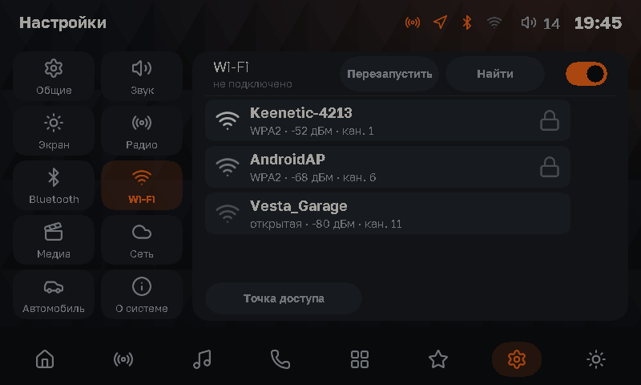

Нажмите на сеть, чтобы подключиться. Пароль спрашивается один раз. «Сохранённые» — все
запомненные сети, там же «Забыть» (нажать дважды). Здесь же включается точка доступа ГУ.

Wi-Fi не находит адрес или не подключается — выключите его переключателем и включите снова. Это полный перезапуск:
радио остаётся выключенным 30 секунд, строка показывает, сколько осталось, потом Wi-Fi включается сам.

**Почему не подключается точка доступа нового телефона.** Wi-Fi ГУ умеет только 2,4 ГГц и защиту WPA/WPA2. WPA3,
защиты служебных кадров (PMF) и 5 ГГц в нём нет, и программой их не добавить: драйвер зашит в прошивку ГУ.

- Точка в режиме «WPA3» или на 5 ГГц ГУ не видна или не подключается совсем.
- Смешанный режим «WPA2/WPA3» VestaHome распознаёт и подключается как к WPA2.
- Точка, которая требует PMF обязательно, откажет ГУ сразу. Режим «WPA2-Personal» телефонов PMF не требует (только
  предлагает), и ГУ подключается к нему без PMF.
- С некоторыми новыми телефонами связь держится несколько секунд и рвётся, не получив адрес. PMF здесь ни при чём,
  причину ищем.

Обычно без проблем подключаются телефоны на Android 9 и старше. На новых выставьте в точке телефона
«WPA2-Personal» и диапазон 2,4 ГГц. Если не помогло, подключите интернет телефона кабелем или по Bluetooth
([Сеть](#сеть)).

### Медиа

Видео (масштаб, видео в движении) и фото (интервал слайд-шоу, масштаб, слайд-шоу при открытии, автоповорот).

### Сеть

Интернет нужен для погоды, пробок, интернет-радио, базы камер и онлайн-карт. Кроме Wi-Fi, подойдёт USB-модем или
телефон — по Bluetooth или кабелем.


#### USB-модем

3G-модем Huawei и похожие (проверен E3121) с SIM-картой.

- **Автоподключение** включено сразу. Вставили модем с SIM-картой — он подключится сам. Связь пропала — VestaHome
  попробует снова через 30 секунд, потом реже, но не реже раза в 5 минут.
- **Подключить / Отключить** — вручную. Строка под «USB-модем» показывает состояние: вставьте модем, нет SIM-карты,
  сигнал, в сети, ошибка. После «Отключить» модем сам не подключится, пока его не вынут и не вставят снова.
- **3G-модем: оператор, APN → Настроить** — отдельный экран:
  - **Оператор модема.** «Авто (по SIM)» выбирает настройки по SIM-карте. Можно выбрать оператора из списка (Россия,
    Казахстан, Беларусь, Узбекистан, Киргизия, Армения, Азербайджан). «Свой» — всё вручную.
  - **APN**, **Логин и пароль** — нажатие открывает клавиатуру. После правки оператор станет «Свой».

#### Телефон по Bluetooth

Интернет телефона, который уже подключён к ГУ по Bluetooth.

1. На телефоне (Android): «Точка доступа и модем» → включите «Bluetooth-модем».
2. На ГУ: «Настройки → Сеть → Телефон (Bluetooth PAN)» → **Подключить**.
3. Строка покажет «в сети» и адрес.

Звонки и музыка с телефона при этом работают. При большой загрузке сети музыка может прерываться: у них общий канал
Bluetooth.

#### Телефон по USB

«Телефон по USB» включено сразу. Телефон (Android) подключается кабелем к USB-разъёму машины.

- **Интернет.** На телефоне: «Точка доступа и модем» → включите «USB-модем». ГУ подключится само.
- **Android Auto** — [раздел 10](#android-auto).

Выключатель «Телефон по USB» снимает драйвер телефона: ГУ его больше не трогает (только заряжает).

**Режим совместимости** — если ГУ не узнаёт телефон по кабелю: VestaHome пробует любое USB-устройство, а не только
телефоны известных марок.

### Автомобиль

Порт GPS и его скорость, данные CAN и MCU, объём бака (для запаса хода), порт для навигаторов.

#### Камера заднего хода

На заднем ходу поверх всего показывается картинка камеры с разметкой по углу руля. После заднего хода VestaHome
возвращает экран, где вы были. Проверить без заднего хода: «О системе → Диагностика → Камера заднего хода».

#### Порт для навигаторов

«Настройки → Автомобиль → Порт для навигаторов». VestaHome отдаёт данные GPS машины в COM-порт (115200). По умолчанию
это COM6, номер меняется стрелками от COM5 до COM9. Укажите тот же порт в навигаторе.

Навител со старыми настройками сбивает часы ГУ на 2007 год: он ставит время по GPS, а считает его в эпохе GPS
1999–2019. Перед запуском Навитела из «Приложений» VestaHome сам ставит в его настройках эпоху 2019–2038
(`GPSEpoch = 2` в `Userdata\settings*.ini`).

### О системе

Версия, память, «Подробнее» (сведения о ГУ, лицензии, кто поддержал разработку), диагностика, окно питания.

#### Диагностика

«О системе → Диагностика»: проверка экрана и касаний, калибровка, память и диски, кнопки и MCU, звук и видео, поток
CAN и GPS, камера заднего хода, текстовые файлы, проба USB-модема, выключатель журналов
([раздел 12](#12-журналы-и-помощь)).

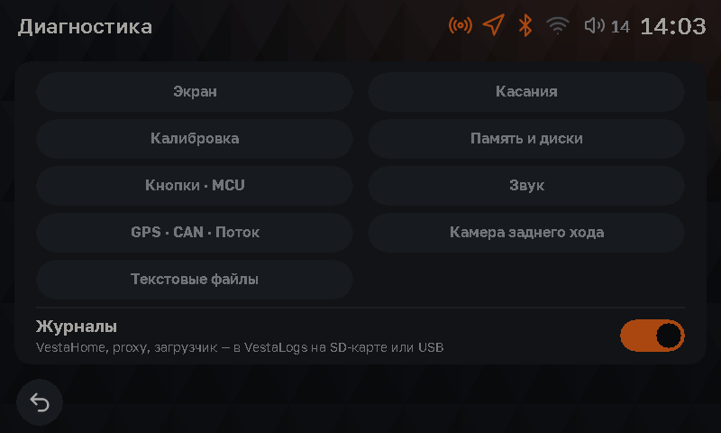

#### Касания

«О системе → Диагностика → Касания»: проверка сенсорного экрана. Серые точки — то, что дал экран, оранжевая линия —
след после фильтра VestaHome. Крестик — точка нажатия. Вверху: касание или перетаскивание, дрожание неподвижного
пальца в пикселях, наибольшее дрожание за все касания и порог перетаскивания (20 px). Если дрожание доходит до порога,
касания могут приниматься за перетаскивание — сообщите автору. **Очистить** — начать заново, **Выход** — назад.

#### Редактор текстовых файлов

«О системе → Диагностика → Текстовые файлы». Открывает `.ini`, `.txt` и `.cfg`.

- Первое нажатие выделяет строку, второе открывает клавиатуру. В строках «ключ=значение» меняется только значение.
- Курсор ставится пальцем. Долгое нажатие на строку ввода — копировать, вставить, очистить.
- **+ СТРОКА**, **УДАЛИТЬ** (дважды), **СОХРАНИТЬ**. Прежний файл остаётся рядом с расширением `.bak`.

#### Окно питания

Кнопка питания в «О системе»:


- **Свернуть** — VestaHome уходит назад.
- **Штатная** — перезагрузить ГУ в штатную оболочку. Перед этим VestaHome переключает звук на радио и выключает свой Bluetooth. Штатная будет запускаться при каждом включении, пока вы не запустите VestaHome вручную (через VestaLaunch или проводник) и не ответите «Да» на «Перезагрузить в VestaHome?». Если штатная после перезагрузки не отвечает, выключите и включите ГУ крутилкой.
- **Выход** — закрыть VestaHome.

Удержание ручки громкости — перезагрузка ГУ. Её можно отменить кнопкой «Отмена».

## 5. Главная и виджеты

**Страницы.** Виджеты листаются пальцем. Точки под виджетами показывают текущую страницу. Шестерёнка в заголовке
виджета открывает его настройки.

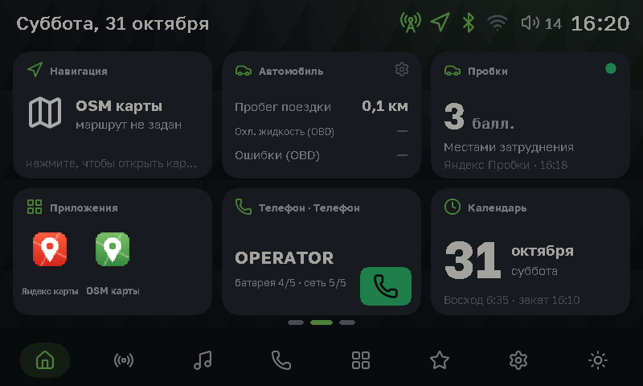

- **Сейчас играет** — то, что звучит: интернет-радио, музыка, радио FM или музыка с телефона. Кнопки ⏮ ⏯ ⏭
  работают для каждого источника. Если ничего не играет, виджет показывает последнее, что вы слушали, и ▶
  продолжает. Есть компактный вариант в одну строку и вертикальный в один столбец: он встаёт рядом с картой OSM
  или другим большим виджетом, обложка у него на фоне. Оба по умолчанию скрыты.
- **Поездка** — пробег, время в движении, средняя и максимальная скорость, когда следующее ТО
  ([ниже](#поездка-и-то)).
- **Скорость** — скорость, направление, высота, спутники. Если впереди камера, виджет показывает её знак и
  расстояние ([ниже](#камеры-контроля-скорости)).
- **Погода** — по GPS или для домашней точки. Источник: Open-Meteo (без ключа), OpenWeather или Яндекс (свой ключ,
  как его получить — [ниже](#ключ-для-погоды)). Домашняя точка в шестерёнке виджета: название, «Широта дома» и
  «Долгота дома» (дробная часть через точку, южная широта и западная долгота — с минусом) или «Из GPS».
- **Пробки** — баллы Яндекс Пробок. По умолчанию для Москвы, город меняется в файле виджета
  ([свои виджеты](#свои-виджеты)).
- **Автомобиль** — три показания на выбор. Нажатие открывает экран «Автомобиль» ([ниже](#экран-автомобиль)).
- **Радио**, **Телефон** (оператор, батарея, вызов), **Календарь** (дата, восход и закат), **Навигация** (открыть
  навигатор), **Приложения** (ярлыки программ).
- **Карта OSM** — живая карта вокруг машины из OSMapsCE. Если едете по маршруту, на других экранах следующий манёвр виден в верхней строке; нажмите на него, чтобы открыть карту. Во время маршрута карта повёрнута по ходу движения, на ней
  следующий манёвр, время прибытия и остаток пути.

### Настроить главный экран


«Настройки → Общие → Виджеты главной». Стрелки двигают виджет раньше или позже. Глаз показывает или выключает его.

### Поездка и ТО

В шестерёнке виджета «Поездка»:

- пробег сейчас — вводим как на приборной панели, дальше VestaHome считает его сам по скорости;
- пробег и дата прошлого ТО — точки в дате ставятся сами: 14112026 → 14.11.2026;
- «Межсервисное ТО»: включено — ТО каждые 7000 км или раз в год; выключено — по регламенту Весты, каждые 15 000 км
  или раз в год; считается то, что наступит раньше;
- кнопка «ТО пройдено» отмечает ТО сегодняшним днём на текущем пробеге.

### Камеры контроля скорости

Шестерёнка виджета «Скорость»:

- **Предупреждать о камерах** — знак на виджете и в верхней строке.
- **Звуковой сигнал** — «Выкл», «Всегда» (на каждую камеру) или «Превышение» (только если вы едете быстрее лимита
  камеры на заданный порог).
- **Порог превышения** — кнопками − и +, по 1 км/ч.
- **Дистанция** — за 10 секунд до камеры (по скорости) или 200, 400, 600 м.
- **Скачать базу камер** с speedcamonline.ru: выберите регионы (например, Москва — 77, область — 50) и типы камер.
  «Раз в неделю» — база обновляется сама. Можно взять и **файл камер** формата iGO или Navitel.
- **Камеры из карт OSMapsCE.** Если на карте памяти или флешке есть регионы загрузчика OSMapsCE-Maps
  (`OSMapsData\<регион>\speedcam.txt`, база openspeedcam.net), камеры берутся из них (из всех регионов, без
  повторов), а свой файл не читается. Строка «Файл камер» показывает, откуда камеры сейчас.

### Ключ для погоды

Open-Meteo выбран сразу и работает без ключа. Для OpenWeather и Яндекса нужен свой бесплатный ключ: его получают
на компьютере или телефоне, а на ГУ вводят один раз.

**Куда вводить.** Виджет «Погода» → шестерёнка → «Источник» (выберите OpenWeather или Яндекс) → «Ключ API» →
наберите ключ → «Готово». Ключ длинный, набирайте внимательно: одна ошибка — и строка «Состояние» покажет ошибку
сервера. Советую сохранить ключ в txt-файл на SD-карту и скопировать его оттуда через
[текстовый редактор](#редактор-текстовых-файлов): откройте файл, выделите строку, нажмите на неё ещё раз, долгое
нажатие на строку ввода → «Копировать». Потом в поле «Ключ API» долгое нажатие → «Вставить».

**OpenWeather** (openweathermap.org):

1. Откройте [home.openweathermap.org/users/sign_up](https://home.openweathermap.org/users/sign_up), заполните имя,
   почту и пароль, подтвердите возраст и согласие с условиями → «Create Account».
2. Откройте письмо от OpenWeather и подтвердите почту.
3. Войдите и откройте вкладку «API keys» ([home.openweathermap.org/api_keys](https://home.openweathermap.org/api_keys)).
   Там уже есть ключ «Default» — 32 знака из цифр и латинских букв a–f.
4. Новый ключ начинает работать не сразу: до 2 часов. До этого сервер отвечает ошибкой 401.

Бесплатного тарифа хватает с запасом: VestaHome спрашивает погоду раз в 30 минут и ещё при нажатии на виджет.

**Яндекс Погода** (тариф «Погода для умного дома»):

1. Откройте [yandex.ru/pogoda/b2b/smarthome](https://yandex.ru/pogoda/b2b/smarthome) и войдите своим Яндекс ID.
2. Подтвердите номер телефона кодом из SMS и примите условия. Тариф бесплатный и только для личного
   некоммерческого использования.
3. На странице тарифа появится ключ — строка вида `xxxxxxxx-xxxx-xxxx-xxxx-xxxxxxxxxxxx` (36 знаков с дефисами).

У этого тарифа 30 запросов в сутки и 1000 в месяц. VestaHome сам не делает больше 30 запросов за сутки. Когда они
кончились, погода до конца суток берётся из Open-Meteo. Часы ГУ должны быть выставлены (их ставит GPS): без них
VestaHome Яндекс не спрашивает.

### Экран «Автомобиль»

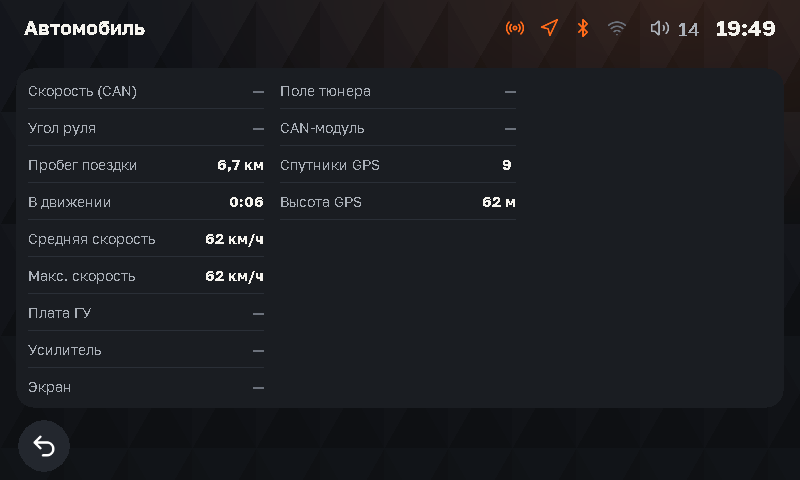

Нажмите на виджет «Автомобиль»: скорость и угол руля (от CAN-модуля), поездка, температуры ГУ, GPS. Прочерк
значит, что этого значения сейчас нет.

OBD-адаптер (ELM327) в этой версии выключен: он мешал телефону подключаться. Он вернётся в следующей версии.

### Свои виджеты

Виджет — файл `<имя>.ini` в папке `VHContent\VHWidgets` на встроенном разделе (`\ResidentFlash`) или на SD-карте (`\SDMemory`). Со встроенного раздела он готов сразу при запуске VestaHome. Виджет, скрипт которого часто пишет файлы рядом с собой, держите на SD: так не изнашивается встроенная память. Установщик кладёт на встроенный раздел примеры, в том числе виджет «Пробки», и описание полей `README.txt`.

- Виджет может брать данные из интернета (`url=`) или из своего скрипта.
- Показать, скрыть, переставить — «Настройки → Общие → Виджеты главной».
- Изменить — там же нажмите на название своего виджета. Откроется встроенный редактор.
- Скачанные данные хранятся в оперативной памяти. После выключения ГУ они скачаются заново.

---

## 6. Радио


Частота крупно, под ней диапазон и RDS: название станции и радиотекст. Стрелки по краям шкалы ищут станцию вниз или
вверх. Пресеты: FM1, FM2, FM3 по 8 станций, УКВ, СВ. Страницы пресетов листаются свайпом. Короткое нажатие на пресет
включает станцию, долгое сохраняет туда текущую.

- **PTY** — поиск станции по жанру.
- **Автопоиск** («Радио → Станции → Автопоиск») проходит весь диапазон и показывает до 30 станций списком, по 5
  на странице. Пресеты при этом не меняются. Чтобы записать найденное в пресеты, нажмите **В пресеты** и в течение 4 секунд ещё раз.
  Станции лягут в пресеты 1–24 по порядку частот.

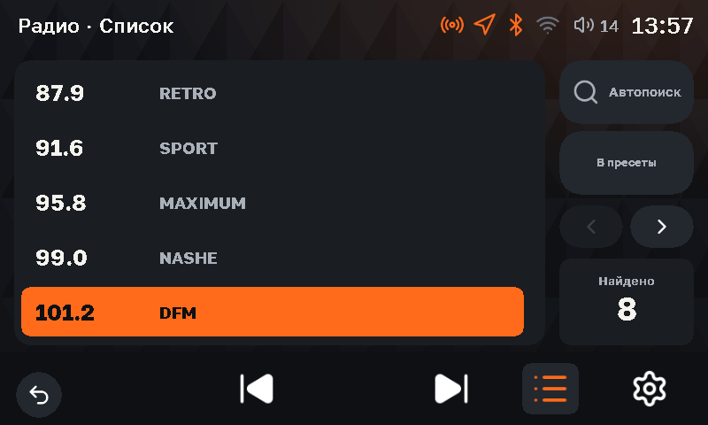

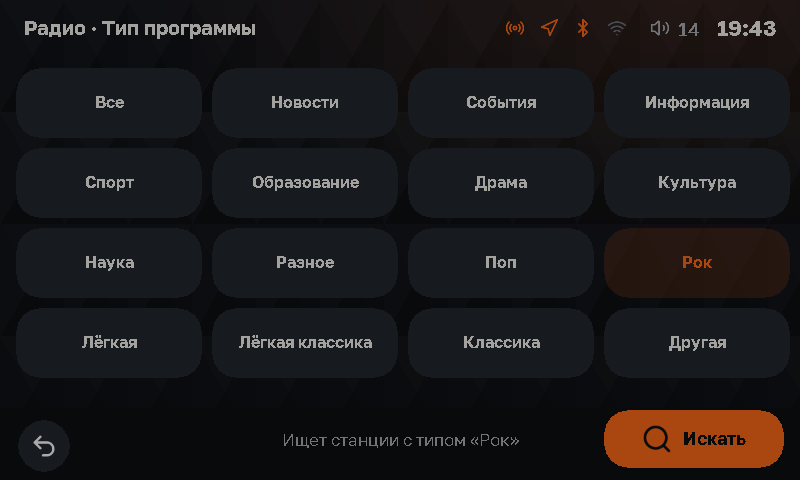

Настройки радио (RDS, AF, TA, CT, MS, шумоподавление, СВ) — «Настройки → Радио».

### Название и логотип станции

RDS часто не показывает название станции или показывает его неверно. Поэтому VestaHome берёт название по городу и
частоте: город определяется по последнему месту GPS, без GPS — по домашней точке. Если станции нет в таблице, берётся
название из RDS. Логотип станции стоит слева от частоты. Он же показывается на виджетах: в «Сейчас играет» — на
месте обложки (в высоком виджете — затемнённым фоном на всю карточку), в виджете «Радио» — справа.

**Логотип из интернета.** Если логотипа станции нет, а интернет есть, VestaHome ищет его сам в каталоге
radio-browser.info по названию станции и стране (по GPS или домашней точке) и сохраняет в `RadioLogos\logos\` —
на SD-карту, без неё во встроенную память. Дальше логотип работает без интернета. Картинки меньше 96 точек не
берутся. Не нашлось — VestaHome не спрашивает про эту станцию 30 дней (список — `RadioLogos\net_miss.txt`, его
можно удалить). Название из RDS латиницей находит только станции, записанные в каталоге латиницей.

Таблица и логотипы ставятся отдельным архивом `RadioLogos-<версия>.zip`:

1. Распакуйте архив на компьютере. В нём папка `VHContent\RadioLogos`.
2. Скопируйте папку `VHContent` из архива в `\ResidentFlash\` на ГУ с заменой. Должно получиться
   `\ResidentFlash\VHContent\RadioLogos\`. Можно и на SD-карту: `\SDMemory\VHContent\RadioLogos\`.
3. Откройте экран «Радио».

**Свой логотип.** Если логотипа вашей станции нет, положите картинку в `\ResidentFlash\VHContent\RadioLogos\logos\` (или в ту же папку на SD-карте) и
назовите файл как станцию: `Радио Вера.png` или `Радио Вера.jpg`. Частота не нужна. Регистр, пробелы, знаки и
слова «Радио» в начале и «радио»/«FM» в конце не важны, русские буквы можно писать и латиницей: файл `DFM.jpg`
подойдёт и к «Радио DFM» из таблицы, и к `DFM` из RDS. Лучше квадрат 192×192 без прозрачности (прозрачное может стать чёрным). Чтобы новый файл появился на экране, перезапустите VestaHome.

---

## 7. Медиа


Вкладки: **Музыка**, **Интернет**, **Bluetooth**, **AUX**, **Видео**, **Фото**.

- **Музыка** — файлы с SD-карты, флешки и встроенной карты. Сверху путь: «‹» ведёт на уровень выше, нажатие на путь
  меняет носитель. Плеер показывает теги и обложку. Обложка берётся из самого mp3, а если её там нет — из картинки
  в папке трека: `cover`, `folder`, `front` (.jpg или .png) или единственная картинка в папке. Есть «Играть всё»,
  повтор и случайный порядок.
- **Интернет** — интернет-радио. Кнопка списка вверху справа открывает станции. Над станциями четыре вкладки:
  - **Мои станции** — из файла `radio.txt` рядом с программой, его можно дополнить;
  - **Избранное** — станции, у которых вы нажали звёздочку ☆. Звёздочка есть у каждой станции и в плеере рядом
    с названием. Нажмёте ещё раз — станция уйдёт из избранного;
  - **Недавние** — 20 последних станций, которые вы включали, последняя сверху;
  - **Каталог** — тысячи станций со всего мира (radio-browser.info). Выберите «Популярные», страну, где вы сейчас (вторая плитка, по GPS; без GPS — «СНГ»), жанр,
    страну или язык. Станции подгружаются по 20 штук, дальше — «Ещё 20». «Поиск» ищет станцию по названию. Кнопка
    «Каталог» над станциями возвращает к выбору и к вкладкам.

  ⏮ ⏭ и кнопки на руле листают станции того списка, из которого играет станция. Он написан в плеере над
  названием, нажатие на эту строку открывает список.

  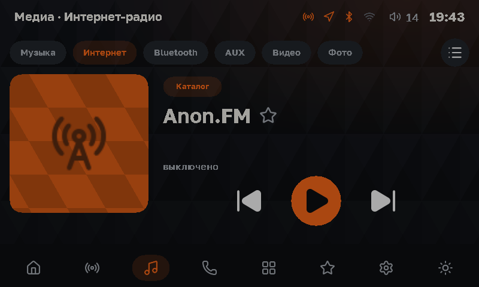

  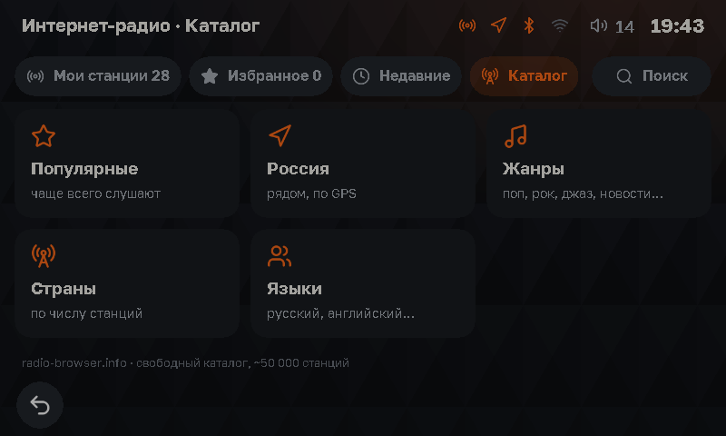
- **Bluetooth** — музыка с телефона: трек, ⏮ ⏯ ⏭.
- **AUX** — звук с разъёма 3,5 мм. Вкладка включает этот вход, как пункт AUX штатного меню. Громкость регулируется
  на самом источнике.
- **Видео** — плеер на весь экран. В движении картинка встаёт на паузу (настройка «Видео в движении»,
  «Настройки → Медиа»).
- **Фото** — миниатюры, просмотр на весь экран, поворот, слайд-шоу.

---

## 8. Телефон


Разделы телефона — вкладки сверху: **Набор**, **Контакты** (книга телефона или SIM, поиск), **Избранное**
(звёздочка в карточке контакта) и **Журнал** (входящие, исходящие, пропущенные). На «Наборе» слева номер и клавиши,
зелёная кнопка — вызов, справа последние звонки (нажатие — перезвонить). Если телефон не подключён, справа кнопки
«Подключить» и «Сопряжённые». При входящем звонке окно открывается само.
Кнопка «телефон» на руле отвечает, «положить трубку» завершает разговор.

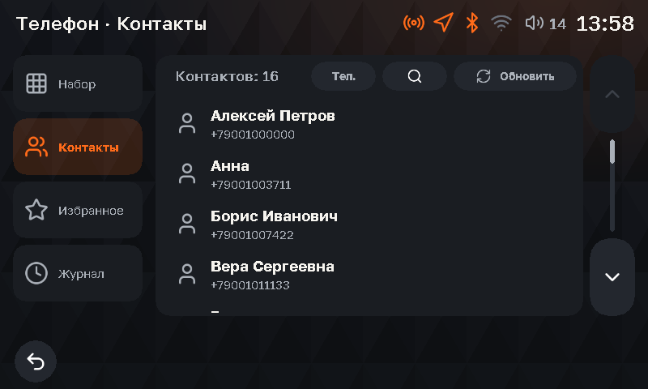

Подключить новый телефон и настроить Bluetooth — «Настройки → Bluetooth» ([раздел 4](#bluetooth)).

---

## 9. Приложения

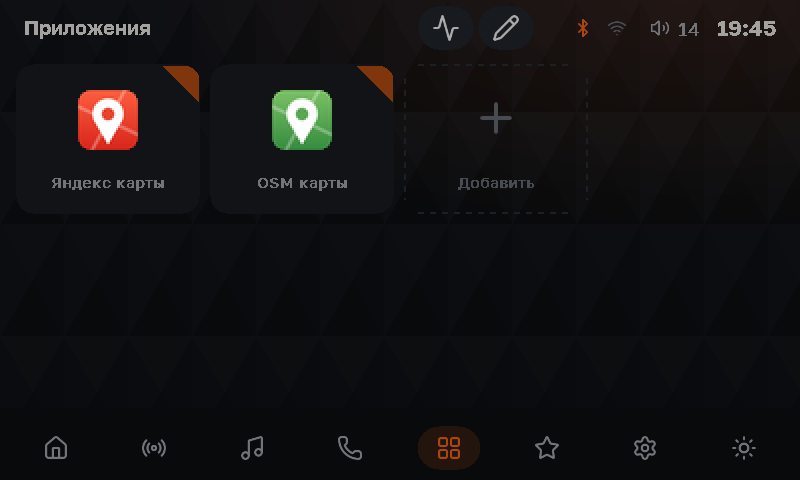

Ярлыки программ, например навигатора. Карандаш вверху включает правку: нажмите на ярлык, чтобы
поменять название, программу, параметры и значок, или на «Добавить». Не забудьте нажать **СОХРАНИТЬ**.

### Диспетчер задач

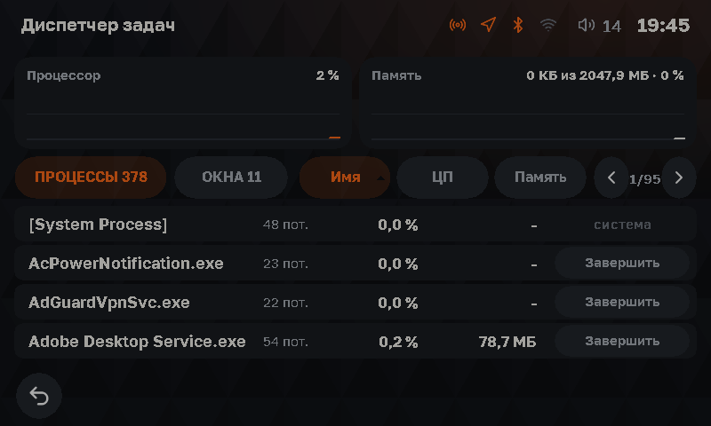

«Приложения → значок активности». Графики загрузки процессора и памяти, вкладки «Процессы» и «Окна». Выберите строку
и нажмите «Переключиться» или «Завершить».

---

## 10. Дополнения

Дополнение — отдельная программа. Она добавляет в VestaHome виджеты, экраны и до двух кнопок в нижнюю панель
(между «Приложениями» и «Настройками»).
Дополнения лежат в папке `VHContent\VHPlugins` на `\ResidentFlash` или `\SDMMC` (`VHPlugins\<Имя>\<Имя>.exe`) и запускаются вместе с VestaHome. С SD-карты и USB-диска дополнения не запускаются: если вынуть карту, работающее с неё дополнение погибнет. Строка состояния тогда скажет перенести его в `\ResidentFlash`.
«Настройки → Общие → Дополнения» — список, состояние, кнопка «Открыть» и выключатель. Описание для разработчиков —
[plugin-api.md](plugin-api.md).

### Android Auto

Телефон (Android) подключается кабелем к USB-разъёму машины. Нужен включённый «Телефон по USB»
(«Настройки → Сеть», [раздел 4](#сеть)).

Откройте на ГУ значок Android Auto и подключите кабель: телефон сам перейдёт в Android Auto, на ГУ
появится его экран, звук идёт через динамики машины. В VestaHome без отключения кабеля — MUTE дважды; обратно —
значок Android Auto. Кнопки руля «вверх / вниз» переключают треки телефона, пока на экране Android Auto (нужна
VestaAuto 1.4 и новее).

**Первое подключение.** Телефон должен быть разблокирован и с интернетом: Android Auto может предложить обновиться.

1. На экране ГУ Android Auto предупредит об использовании данных машины и местоположения — нажмите «Продолжить».
2. На телефоне по очереди появятся запросы доступа: контакты, звонки, SMS, местоположение, микрофон,
   уведомления. Разрешите все: без них не будет звонков, сообщений и голосового управления. Местоположение —
   «Разрешить всегда».
3. Если на ГУ появилась кнопка «Перейти в настройки» (Android Auto просит доступ к уведомлениям), нажмите её.
   На телефоне откроется список «Доступ к уведомлениям»: включите переключатель у Android Auto и подтвердите
   «Разрешить». Вернитесь на ГУ — настройка продолжится.
4. Если кнопка не открыла настройки, включите доступ на телефоне вручную: «Настройки → Приложения → Специальный
   доступ → Доступ к уведомлениям → Android Auto». На разных телефонах путь немного отличается; проще всего
   набрать в поиске настроек «доступ к уведомлениям».

Дальше телефон подключается сам, разрешения больше не спрашиваются.

---

## 11. Безопасность и возврат к штатной оболочке

Штатная оболочка остаётся на ГУ. Она запустится вместо VestaHome, если:

- VestaHome трижды подряд не проработал минуту;
- в корне SD-карты или флешки лежит пустой файл `VestaStub.off`;
- вы нажали «Штатная» в окне питания (до возврата в VestaHome вручную) или «Выход» (до следующего включения).

**Если что-то пошло не так**

Папки `SPIPower_rescue` и `SafeMode` лежат в том же архиве, что и установщик (`VestaHomeInstall-<версия>.zip`),
рядом с папкой `VestaHomeInstall`. Сохраните распакованный архив на компьютере до установки.

- ГУ перезагружается по кругу после установки. Оставьте SD-карту в слоте: установщик сам вернёт заводские
  файлы.
- Не помогло. На компьютере скопируйте в корень SD-карты содержимое папки `SPIPower_rescue` из архива. Вставьте
  карту и включите ГУ. Появится «Update Start!» или «OK» — нажмите.
- Оболочка совсем не загружается. Скопируйте в корень SD-карты содержимое папки `SafeMode`. После включения
  запустится проводник, наши программы будут отключены.

Подробности — в файле `help.txt` рядом с установщиком.

---

## 12. Журналы и помощь

Журналы выключены по умолчанию. Включатель: «О системе → Диагностика → Журналы». Журналы пишутся только на SD-карту
или флешку, в папку `VestaLogs`. Во встроенную память ГУ они не пишутся никогда.

При проблеме пришлите:

- папку `\SDMemory\VestaLogs` целиком;
- `\SDMemory\SPIPower_boot\boot.log`, если проблема при загрузке;
- фото экрана установщика с отчётом.

Вопросы и ошибки — в [Issues](https://github.com/TpuPyku/VestaHome/issues).

---

## 13. Другие наши программы

- **OSMapsCE** — карта OpenStreetMap с пробками, офлайн-карты областей, поиск и маршруты без
  интернета. При запущенном VestaHome добавляет на главную виджет «Карта OSM». Нажатие на виджет открывает карту на
  весь экран. [github.com/TpuPyku/OSMapsCE](https://github.com/TpuPyku/OSMapsCE)
- **YaMapsCE** — карта Яндекса с пробками. [github.com/TpuPyku/YaMaps](https://github.com/TpuPyku/YaMaps)
- **VestaLaunch** — запуск программ с кнопки «Навигация» штатной оболочки.
  [github.com/TpuPyku/VestaLaunch](https://github.com/TpuPyku/VestaLaunch)

**Поддержать проект.** Поставьте ⭐ звезду репозиторию [VestaHome](https://github.com/TpuPyku/VestaHome) — так его
проще найти другим. Поддержать разработку можно на [Boosty](https://boosty.to/vesta_home): это добровольно, VestaHome остаётся бесплатным.
