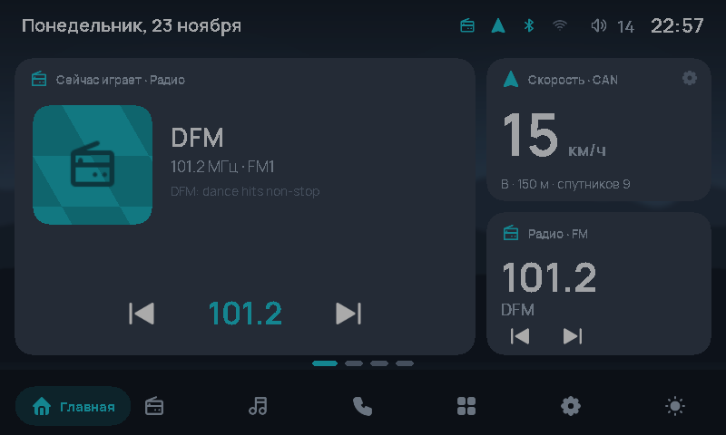

# Своё оформление VestaHome (user_skin.ini)

Цвета, фон, значки и шрифт VestaHome меняются одним текстовым файлом `user_skin.ini` и картинками рядом с ним. VestaHome читает файл при запуске.

## 1. Куда класть

Папка для своего оформления:

- `\ResidentFlash\VHContent\Skin\` — внутренняя память ГУ (рекомендуется);
- или `\SDMemory\VHContent\Skin\` — SD-карта. Для быстрых тестов. Для постоянного использования не применяйте.

Если файл есть в обеих, сильнее тот, что на `\ResidentFlash`. Обновления VestaHome папку `VHContent` не трогают: ваше
оформление переживёт любое обновление.

Создайте папку `Skin`, если её нет, положите туда `user_skin.ini` и картинки, затем перезапустите VestaHome
(«О системе» → питание → «Выход», или выключите и включите ГУ).

**Вернуть как было:** удалите `user_skin.ini` (или всю папку `Skin`) и перезапустите VestaHome.

## 2. Как устроен файл

Обычный текстовый файл, кодировка UTF-8. Три раздела: `[colors]`, `[images]`, `[fonts]`. Каждая строка —
`ключ = значение`. Всё после `;` — комментарий.

Пишите **только то, что меняете**: всё, чего нет в вашем файле, берётся из встроенного оформления (`Skin\skin.ini`
в папке программы). Ошибка в строке или файл, которого нет, — эта строка просто не действует, VestaHome не падает.

```ini
; мой вариант: синий акцент
[colors]
accent = 2E7DD7
```

## 3. Цвета — `[colors]`

Цвет — шесть шестнадцатеричных цифр `RRGGBB`, без `#` (например, `FF6B1A` — оранжевый).

| Ключ | Что красит | Встроенный |
|---|---|---|
| `ink` | фон всех экранов (под узором) | `0E1013` |
| `panel` | карточки, плитки, виджеты | `1A1D22` |
| `panel2` | кнопки, «пилюли», вложенные карточки | `23272E` |
| `line` | разделители, дорожки ползунков | `2A2F37` |
| `text` | основной текст и встроенные значки | `F5F3EE` |
| `muted` | второстепенный текст | `AAB0B8` |
| `dim` | неактивный текст | `6C727C` |
| `accent` | нажатая кнопка, выбранное, заголовки, полоса нижней панели | `FF6B1A` |
| `facet` | уголок плитки в «Приложениях» | `C24A0B` |
| `off` | недоступное | `3D424A` |
| `ok` | «принять звонок» | `2FBF71` |
| `stop` | «сбросить», пропущенный звонок | `E8483B` |
| `margin` | поля вокруг фото | `08090A` |
| `mosaic1`…`mosaic4` | треугольники встроенного фона (левый, правый, верхний, нижний в ячейке) | `171A20` `121419` `1B1E24` `0F1114` |

Что важно знать:

- **Акцент.** Акцент можно выбрать и без файла: «Настройки → Экран → Тема». Если `accent` задан в `user_skin.ini`,
  он главнее, в «Теме» тогда написано «задан в user_skin.ini». `facet` без `accent` считается от акцента сам.
- **Ночь.** В ночном режиме VestaHome делает все цвета и картинки на треть темнее. Отдельной ночной палитры не
  нужно: подбирайте цвета под день.
- **Контраст.** `text` должен хорошо читаться на `panel` и на `ink`; `muted` — заметно светлее `panel`. На солнце
  тёмно-серые надписи пропадают первыми.
- `mosaic1`…`mosaic4` действуют, только пока нет своего фона (`background` / `tile`, ниже).

## 4. Картинки — `[images]`

Картинки — PNG (можно с прозрачностью), фоны — PNG или JPG. Файлы лежат в той же папке `Skin`. Строка —
`ключ = имя_файла`.

### Фоны

| Ключ | Что это | Размер |
|---|---|---|
| `background` | фон главного экрана (вместо мозаики) | 800 × 480 |
| `tile` | узор, повторяется по фону **всех** экранов (и главного, если нет `background`) | от 8 до 400 пикселей по каждой стороне |
| `saver` | фон заставки | 800 × 480 |

- `background` действует **только на главном экране**. Чтобы рисунок был на всех экранах, задайте только `tile`
  (без `background`): он ляжет и на главный.
- Плавный фон на всех экранах — `tile` в виде узкой вертикальной полосы, например 8 × 400 с градиентом: она
  повторится по ширине, а под нижней панелью (ниже 400 пикселей) начнётся сначала — там её почти не видно.
- Пейзаж на всех экранах — `tile` 400 × 400, у которого правый край продолжает левый: на экране он ляжет два раза
  по ширине без шва.
- Каждая картинка занимает память ГУ: фон 800 × 480 — около 750 КБ, значок 64 × 64 — около 16 КБ. Памяти у ГУ
  мало: не кладите лишнего.
- Своя заставка — ещё и в настройках: «Экран → Заставка → Своя картинка» (любая картинка с диска), без файла.

### Карточки

| Ключ | Что это | Размер |
|---|---|---|
| `card` | картинка карточек вместо сплошного цвета `panel`: виджеты главного экрана, карточки настроек, пресеты радио, плитки | любой; удобно 128 × 96 |
| `card_small` | своя картинка для плиток ниже 100 пикселей (пресеты радио, разделы настроек); без неё — `card` | любой |

- Картинка — PNG с прозрачностью: сквозь прозрачные места виден фон. Так делается «стекло».
- Картинка **растягивается** на каждую карточку, а **углы скругляет VestaHome** сам. Поэтому рисуйте её без
  скруглений и без рамки (рамка растянется и станет толще на больших карточках). Подходят плавные градиенты,
  прозрачность, мягкие цветные пятна.
- Пиксели берутся без сглаживания: при растяжении в 6 раз резкие детали станут ступеньками, плавные градиенты — нет.
- Нажатая карточка — по-прежнему цвета акцента, выбранная — мягкий акцент поверх фона. Ночью картинка на треть
  темнее, как всё остальное.
- Кнопки и «пилюли» (цвет `panel2`) остаются сплошными: на прозрачной карточке их так лучше видно.
- Прозрачность рисуется для каждой точки карточек при каждой перерисовке. Если на ГУ листание станет заметно
  медленнее — сделайте картинку менее прозрачной или уберите строку `card`.

### Значки

Значки квадратные, рисуются с масштабом: 60 пикселей на плитках, 40 на кнопках, другие размеры на остальных
экранах. Делайте их 64 × 64 или 128 × 128, белыми на прозрачном фоне: на многих экранах VestaHome сам
перекрашивает значок в цвет экрана (если значок не цвета `text`).

Проще всего — **положить файл с тем же именем, что во встроенном оформлении**: свой `radio.png` в `VHContent\Skin\`
заменит встроенный без строки в `user_skin.ini`. Или строкой: `radio = my_radio.png`.

Основные имена значков (полный список — раздел `[images]` в `Skin\skin.ini` программы): `home`, `radio`, `music`, `phone`, `apps`, `settings`, `map`,
`nav`, `night`, `day`, `prev`, `next`, `play`, `pause`, `rew`, `fwd`, `exit`, `folder`, `shift`, `backspace`,
`aux_ico`, `photo`, `video`, `info`, `bt`, `usb`, `list`, `vol`, `search`, `shuffle`, `repeat`, `call`, `hangup`,
`wifi`, `star`, `star_f`, `user`, `users`, `clock`, `keypad`, `mic_off`, `handover`, `rot_l`, `rot_r`, `warn`.

`<имя>_down` — отдельная картинка нажатой кнопки (например, `radio_down = radio_pressed.png`). Без неё нажатый
значок просто затемняется.

### Картинка загрузки

Картинка, которая видна, пока VestaHome запускается, лежит не в `VHContent`, а в папке `Skin` самой программы:
`\ResidentFlash\VestaHome\Skin\bootmy.png` (или `.jpg`), 800 × 480.

## 5. Шрифт — `[fonts]`

```ini
[fonts]
regular = Roboto-Regular.ttf  ; файлы .ttf в этой же папке
bold    = Roboto-Bold.ttf
```

Нужны оба файла: обычный и жирный. Шрифт должен содержать кириллицу. Крупные шрифтовые файлы (несколько МБ) замедляют
запуск.

Имя шрифта VestaHome читает из самого файла `regular`, писать его не нужно. Строка `face = …` необязательна: она
работает, только если в файле имени нет. Если в `face` написано не то имя, что в файле, берётся имя из файла, а в
журнале появляется строка `шрифт: в user_skin.ini face = «…», в файле «…» — взято из файла`.

Подходят только обычные TrueType `.ttf` с отдельными файлами начертаний. Вариативные (`Font[wght].ttf`,
`…-Variable.ttf`) и `.otf` Windows CE не понимает.

## 6. Пример: тема Blue Mist («Синий туман»)

Тёмный сине-серый фон с силуэтом холмов на всех экранах, полупрозрачные карточки-«стекло» с сиреневым,
лилово-розовым и бирюзовым отсветами (у мелких плиток — только стекло), бирюзовый акцент, залитые
значки (Tabler Icons, лицензия MIT — файлы с именами встроенных: `home.png`, `radio.png`…), шрифт Manrope
(лицензия SIL OFL).

| День | Ночь |
|---|---|
|  |  |

```ini
[colors]
ink     = 121821   ; фон
panel   = 2B3442   ; карточки, плитки, виджеты
panel2  = 364152   ; кнопки, «пилюли»
line    = 435066   ; разделители
text    = F2F5F9   ; основной текст и значки
muted   = 9FAEC0   ; второстепенный текст
dim     = 67768B   ; неактивный текст
accent  = 1FC8D8   ; акцент
facet   = 0F8C9C   ; уголок плитки
off     = 3C4656   ; недоступное
margin  = 0A0E14   ; поля вокруг фото

[images]
tile       = mist_tile.png   ; фон всех экранов: 400 x 400, повторяется
saver      = mist_saver.png  ; заставка, 800 x 480
card       = mist_card.png        ; карточки: полупрозрачное стекло с цветными отсветами
card_small = mist_card_small.png  ; плитки ниже 100 px: только стекло

[fonts]
face    = Manrope
regular = Manrope-Regular.ttf
bold    = Manrope-Bold.ttf
```

Шрифт из интернета сначала подготовьте: GDI Windows CE не понимает «вариативные» шрифты (`Font[wght].ttf`) —
нужны отдельные файлы обычного и жирного начертания. Без сглаживания текст ровнее, если шрифт прогнан через
ttfautohint.

## 7. Проверка на компьютере (ПК-сборка VestaHome)

Тему удобно делать на компьютере с Windows: `VestaHomePC.exe` — тот же VestaHome. Он
читает тему так же, как на ГУ, только из папки рядом с собой. Архив темы Blue Mist уже содержит ПК-сборку
(папка `VestaHomePC`) с темой внутри.

1. Распакуйте папку `VestaHomePC` куда угодно (например, на рабочий стол). В ней:
   `VestaHomePC.exe`, `Skin\` (встроенное оформление — его не меняйте), `Fonts\` и `VHContent\Skin\` — **сюда
   кладётся ваша тема** (`user_skin.ini`, картинки, значки, шрифты).
2. Запустите `VestaHomePC.exe` — откроется окно с VestaHome в вашей теме.
3. Поменяли файл — закройте окно (`Esc` или крестик) и запустите снова: тема читается при запуске.
4. Готово — скопируйте содержимое `VHContent\Skin\` на ГУ в `\ResidentFlash\VHContent\Skin\` (или на SD-карту в
   `\SDMemory\VHContent\Skin\`) и перезапустите VestaHome.

Управление: мышь — палец (нажатие, перетаскивание — листание), `N` — день / ночь (проверьте тему в обоих),
`C` — входящий звонок для проверки (ещё раз — конец звонка), `Esc` — выход. День и ночь также в «Настройки → Экран».

Что учесть:
- На компьютере нет ГУ: радио, Bluetooth-телефона, CAN машины. Эти экраны пустые или с демонстрационными
  данными — для проверки цветов и значков этого хватает.
- Компьютер не покажет нехватку памяти: размеры картинок держите в рамках раздела 4.
- Тема не взялась — проверьте путь `VHContent\Skin\user_skin.ini` рядом с exe и раздел 8.
- Окно на экране компьютера ярче и контрастнее экрана ГУ: последнюю проверку делайте в машине, днём и ночью.

## 8. Если что-то не так

- **Ничего не поменялось.** Файл называется именно `user_skin.ini` (не `user_skin.ini.txt` — Windows прячет
  расширения), лежит в `VHContent\Skin\`, перезапустите VestaHome.
- **Цвет не тот.** Шесть цифр без `#` и без пробелов внутри; раздел `[colors]` написан с квадратными скобками.
- **Картинки нет.** Имя файла совпадает до буквы, файл в той же папке; фон `tile` — не больше 400 пикселей по
  стороне, `background` и `saver` — ровно 800 × 480.
- **Шрифт не поменялся.** Нет ли в `\ResidentFlash\VHContent\Skin\` второго `user_skin.ini` со своим `[fonts]`: он
  сильнее файла на SD-карте. С включёнными журналами («Диагностика → Журналы») в `VestaHome.log` есть строка
  `шрифт: …`: `шрифт: <имя> (своих загружено 2 из 2)` — ваш шрифт взят; `… не загрузился (нужен TrueType .ttf)` или
  `шрифт: Golos Text …` — ваш файл не подошёл (имя файла, папка, формат — раздел 5); `жирный файл другого семейства`
  — у жирного файла другое имя внутри, жирный текст рисуется из обычного.
- **Неразборчиво на солнце.** Сделайте `text` светлее, а `panel` темнее.
- Те же ключи понимает VestaLaunch: один файл цветов подходит обеим программам.
